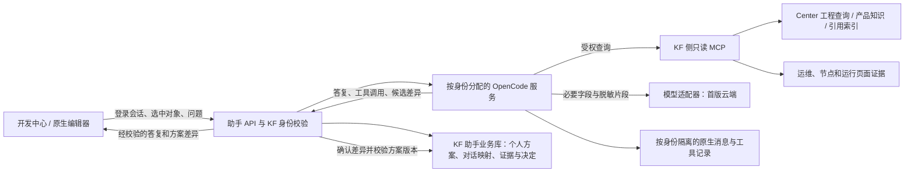

<!-- modified by jinlong.feng at 2026-11-20 KF开发助手首版技术架构与实施计划 -->
# KF 开发助手 V1 技术架构与实施计划

<!-- modified by jinlong.feng at 2026-11-24 KF业务公式独立执行 -->
独立公式执行候选版 `c620fa7b3e38` 已冻结。开发回归 183/183，试点回归 56/56。三个冻结版的独立题记录保留。发布条件仍为新题初版与变更版各一次确认、保存正文一致以及专用 App 正常、异常及新旧目标赋值次数全部对上。 开发与独立验收
<!-- end -->

<!-- modified by jinlong.feng at 2026-11-24 KF业务预期逐项复核 -->
业务预期逐项复核已冻结。回归 179/179、试点回归 52/52。新题出现设计值 25、复核值 45、独立计算值 10，冻结版停止交付。下一步补可执行的独立数值复核和对话失败诊断，再验初版、变更版、保存和运行；M6 保留 `67089443fe25`。 逐项核对与实测记录
<!-- end -->

<!-- modified by jinlong.feng at 2026-11-24 KF确认口径执行校验 -->
业务口径执行校验候选版 `2dadd7b42b96` 已冻结。M6 继续运行 `67089443fe25`。下一项验收先查独立复核的字段和逐项差异，再从原对话单次确认走到两版正文、专用 App 的回包与新旧变量写入次数。 开发与独立验收记录
<!-- end -->

<!-- modified by jinlong.feng at 2026-11-24 KF工程变量实名交付 -->
M6 本机试点已更新至 `67089443fe25`。车型/颜色首次盲验暴露沿用条款遗漏，记录保留。修订后换用报文解码独立题，四轮完成两次确认和交付，18 次专用 App 回读全部通过。 验收记录
<!-- end -->

<!-- modified by jinlong.feng at 2026-11-24 KF脚本确认前事实复核 -->
M6 本机试点已更新到 `22578ffbe276`。首次独立题发现未调用的外层函数导致诊断重复，冻结结果按失败保留；修订版在另一道独立题上通过四轮对话、两版保存和 18 次实机回读。变量写法负对照另测 9 次。下一步可独立改进确认摘要中偶尔残留的测试别名和未使用的局部映射。 实测记录
<!-- end -->

<!-- modified by jinlong.feng at 2026-11-23 KF计算开发态范围确认 -->
当前计算工程按开发态可编辑的六类脚本维护：系统脚本、周期性脚本、数据变化脚本、条件事件脚本、请求式计算脚本和自定义函数。自定义事件已从开发态移除，后续开发任务、M6 验收和覆盖率统计均排除该项。
<!-- end -->

<!-- modified by jinlong.feng at 2026-11-20 KF开发助手M1开工与交互设计 -->
<!-- modified by jinlong.feng at 2026-11-20 KF开发助手M1 -->
**当前进度。** M1 本机联调版已接入实际开发界面、原生二维新标签和周期脚本编辑器。普通账号已走通跨入口续聊与个人方案确认。[实施与验收记录](#m1-delivery) · 启动与试点说明 · UI 设计稿
<!-- end -->
<!-- end -->

<!-- modified by jinlong.feng at 2026-11-20 OpenCode普通权限M0验证 -->
**首版沿 OpenCode 路线进入 M1。** 在 `192.0.2.1` 的现有客户端和计算工程上，两个真实普通账号验证了配置引用、跨重启续聊、个人资料隔离和方案确认。OpenCode 负责模型对话、MCP 调用和消息持久化。KF 助手服务负责解释工程、限制查询范围、核验归属和提交个人方案。原 `agent-app/` 继续弃用。M0 实测、失败用例与复验记录

## 1. OpenCode 选型与适用条件

本轮锁定官方 `opencode-darwin-arm64@1.19.6`。实际运行包提供 `/global/health`、`/doc`、`/mcp`、`/session` 和 `/session/{id}/message`。OpenCode 服务重启后，普通用户从计算入口接着客户端的对话提问，模型引用了重启前后的两条现场证据。保留版本锁定和 API 契约测试，升级时对照**目标二进制**的 OpenAPI 重跑。在线 API 参考与本次运行包存在路径差异。[官方 API 参考](https://opencode.ai/docs/api/) · [官方 MCP 文档](https://opencode.ai/docs/mcp-servers/)

M0 把 OpenCode 放在测试工作站的回环地址上，每个账号有独立运行实例、工作目录和数据目录。KF 工程与账号来自服务器，个人方案存于本机 SQLite。M1 在 Center 一侧新增同源助手 API，以 KF 登录态分配工作进程，浏览器只连接该 API。保留每个身份的历史和证据隔离。生产个人方案库拟用 PostgreSQL，另对 OpenCode 会话库做成对备份恢复演练。Windows/Linux 目标包、实例回收、并发容量、故障恢复与商业分发依赖清单进入试点前验收。开发中心依赖

云端首选可配置供应商。本轮用本地白名单适配器重建请求，只发送测试问题、对象类别、订阅状态、读写方向、匿名引用和证据编号。初测中模型在客户端问题上额外查询了计算工程。修复后，工具服务按本轮入口、权限和预算检查请求，模型每轮只能看到当前入口的参数选项。一轮消费查询额度后继续根据已有证据作答。正式服务将额度绑定到服务端生成的运行 ID 并隔离并发标签页。凭据、原始配置和可读对象的反查留在客户侧。客户本地模型沿用同一适配契约，另行验收。
<!-- end -->

<!-- modified by jinlong.feng at 2026-11-20 OpenCode普通权限M0验证 -->
## 2. 部署边界与单轮请求

| 部件 | 实现契约 |
| --- | --- |
| 入口与编辑器桥接 | 总入口支持无工程提问。工程页随请求带入口类型、工程 GUID、当前子项；报表补工作表和选区；二维与 3D 子窗口补页面或场景、选中对象、编辑会话及草稿序号。原生窗口通过同源、绑定窗口和请求编号的消息交换摘要。子窗直接打开时自行向同源助手入口登记。异步回包带入口序号，切换对象后丢弃旧回包。能力缺失时显示“只能读取已保存配置”。工程状态 · 报表状态 · 二维入口 · 3D 入口 |
| 助手 API | 同源入口校验 KF 登录会话，服务端取得租户与用户 ID。为消息分配持久 ID，断线后按事件游标续传。读取 KF 对象、证据详情、历史引用或确认方案时，分别核验记录归属和当前工程权限。会话令牌只在 KF 侧使用。网关身份校验 · 工程权限入口 |
| 编排与模型 | 顺序为“恢复已确认方案和当前入口 → 选技能及必需事实 → 缺什么查什么 → 校验 → 回答并列出未证实项”。通用操作问题可直接查产品知识。对多义对象提问、覆盖不完整或预算耗尽分别设出口。模型只提出结构化查询及解释结果，服务端检查工具、参数、授权、下一步是否必要及查询预算。工程入口由 KF 宿主下发；每次工具调用核验当前运行和对象范围，默认只查当前对象，展开上游时再追加有依据的读取额度。模型接入封装流式输出、结构化结果、取消、超时和用量统计。首版接通一个云端模型；保留相同契约供客户本地模型适配。 |
| KF 侧 MCP | 一个服务提供 `get_context`、`lookup_reference`、`find_objects`、`read_object`、`trace_refs`、`read_runtime`、`validate_candidate`。按后端操作逐项开放只读能力。库内走权限过滤和字段投影；计算候选脚本只能在独立样例环境接模拟依赖。模型可见的结果带证据 ID、版本、范围、时间与缺口。写点、保存工程、发布、部署、启停均保留在客户操作界面。七个工具及九项技能的契约 |
| 产品知识与运行证据 | 产品知识按构建、平台、模块、对象类型与任务建索引，来源为源码、适配版本手册和独立验收记录。客户配置、草稿、实测数据进入受权证据存储。提供给云端的内容限于命中的字段、脚本片段和必要观测，去除凭据及连接秘密。每次只加载当前技能、相关清单和已有证据摘要。 |

**个人方案和消息的归属。** 以服务端核验的 `tenantId + userId` 查询个人方案、对话、提议、证据。一个方案可以关联多个个人对话；每个对话绑定一个由服务端签发的 OpenCode `sessionId` 和账号专属实例。每次拉取历史或续聊都重查归属，读取历史所引工程时还要重查当前工程授权。切换工程只更新当前入口和选中对象，继续同一对话时复用原会话 ID。新开对话分配新会话 ID，并从同一方案读取已确认版本。消息自动保存；业务层保存消息游标、会话映射及方案版本。M0 的跨进程读回与两个普通账号对照

首批 API 包含“发消息并订阅本轮事件”“按游标恢复事件”“读取个人方案及对话”“确认或拒绝指定差异”。同一对话的运行串行处理，跨对话通过方案版本协调。客户端重发携带同一消息请求 ID；模型超时留下已保存的用户消息及失败状态，可安全重试。模型供应商切换时复用同一套证据结构与校验器。客户内网端点可在后续接入同一适配器测试，首版验收以真实云端调用为准。

**确认和重试。** 将模型提议存为含 `proposalId、basePlanRevision、diff、evidenceIds` 的待确认差异，用户可以继续对话。确认或拒绝走本人登录态的独立 API。事务内按租户、账号、方案与提议重新查找，核验当前版本，写入决定与结果版本。重复相同决定返回首次结果；旧版本提议提示重看差异；拒绝保留记录及原清单。提交后由助手 API 通知同一方案的其他入口刷新。本轮正式清单按本人两次决定从第 0 版依次升至第 1、2 版。第二项来自实际云端提议，OpenCode 停机后仍可确认。重放仍为第 2 版、2 条，另一普通账号不能代确认。M1 应将模型说明、待确认提示与最终条目正文分别存储。
<!-- end -->

## 3. 跨工程引用的实现

第一版在 PostgreSQL 用对象表与引用表建立正反索引。一个对象用租户、工程类型、工程 GUID、对象种类及本地稳定 ID 定位。老工程只有名称或路径时保留工程、父对象、原字段及修订，标为弱标识。部署对象另按节点和 App ID 定位。助手的个人方案清单只限定本次交付范围，同时记录相关工程的业务用途；从共享同一数据源不能推导两个工程属于同一客户方案。

**每条边记录什么。** 源对象、关系种类、目标对象或未解析表达式、所属层与修订、来源字段路径或脚本位置、解析规则版本及证据 ID。明确区分已解析、多个候选、动态未解析和缺少材料。部署到节点的实例选择也形成独立关系。正向沿“消费者读取谁”追，反向沿同一批已核验的边查影响；计算写回使用单独的写入关系。

| KF 链路 | 本地解析规则与实现依据 |
| --- | --- |
| 数采设备 → 点 → 工业数据源 | 从设备及点表取本地 ID、设备、寄存器、类型和读写方向。按数据源类型读取上游工程 ID、实例名、连接方式；结合部署信息核对目标。历史库和外部业务库可作为独立来源。数采接口 · 数据源接口 |
| 客户端变量 → 本工程连接 → 数据源与源点 | `projectDataSourceId` 对应客户端工程内连接行的 `id`。先解到本地别名和 `appName`，再按类型与可见工程或实例解析目标。保留 `dataSourceItem.tagName` 作为原始点名。快加变量支持改名，老记录的连接 ID 可能为空；此时按同工程别名、外部名和点名缩小候选，多结果需客户确认。客户端快加实现 |
| 页面、报表、3D → 变量或资源 | 分别解析控件属性、页面脚本、报表数据集与单元格、场景资源。只支持已登记的对象格式，记录未支持类型。脚本用 TypeScript/JavaScript 语法树提取直接引用和可静态求值的常量，按作用域识别宿主对象与本地变量。动态下标、外部函数或运行时生成的标签返回原片段和缺口。报表数据集 · 真实页面样本 |
| 计算与报警 → 输入、输出和事件源 | 计算脚本按触发器和宿主选择函数目录，分别提取读取与写回对象；持有工程内别名后再定位运行服务。报警输入从词典和本地连接解到目标 `dm_guid`。报警事件输出则沿报警工程型数据源，追到客户端报警窗。采样点、计算结果点和报警事件分别建边。计算脚本读取 · 运行寻址 · 报警连接 |

**索引更新。** 首次按用户问题索引可读工程，记录已覆盖模块和修订。有保存通知时，按对象刷新改变的边；对于其他客户端修改、导入、重命名或旧版本没有通知的情况，按需重读并定期核对修订或内容指纹。单个修订解析完成后事务替换旧边，删除项失效。草稿边只覆盖当前编辑会话的查询视图。权限在读取、反查、计数、分页前核验，缓存按租户、权限范围和修订区分。遍历按对象、层和修订去重以截断循环。宽查询先返回有权查看的类型、数量及覆盖范围，展开时再读原字段。

**贯穿验收的一个查询。** 问“出口压力文字从哪里来”，应定位 `PressureValue.setText`，在 `linkMng.linkList[1].script` 找到 `$System.P_OUT`，再沿工程变量、别名和数采点追上游。问同页报警来源，应从 `StationAlarms.dateSource = Events` 走事件源和报警工程。相同页面得出两条不同证据路径，两问各自只返回所需片段。全页已压紧 JSON 为 13,786 字节，压力示例片段含对象名和路径为 406 字节；实际模型成本在 M7 按完整会话计量。页面字段抽查方法与结果

## 4. 如何区分正在编辑、已保存、已部署、实际运行

四层各自保存观测，可同时成立且内容不同。每条证据至少带对象、层、来源、观察时间、可用的修订或指纹和可见范围。部署与运行另带节点、App ID。回答“改动在哪里生效”时分别展示四层及其关系。未观测、陈旧、相符、冲突分别表示。数据源时间、采样时间、采集证据的时间分开保存并统一时区比较。

| 层 | 从哪里取 | 首版能作的判断与验收 |
| --- | --- | --- |
| 正在编辑 | 当前浏览器编辑器的选中项、相对基础修订的差异、`editorSessionId` 与本地序号。脚本编辑器有未保存列表；原生二维、3D 需专门的只读桥接。 | 两个标签打开同一对象，在 A 修改不保存。A 显示新值和“草稿”，B 仍显示自己的内容。关闭或撤回 A 后草稿覆盖消失。没有草稿接口时返回“编辑状态未知”。脚本编辑器状态 |
| 已保存 | Center 对该工程、对象的正式读回。优先用服务端修订；只提供内容时，对稳定的业务字段做规范化、带规则版本的指纹。对象指纹只证明所包含字段。 | 保存失败或只看到成功提示时仍需读回。保存后刷新能读到新值，发布与运行可继续显示旧值。并发保存时保留各编辑会话的基础修订，提示基础内容已变。 |
| 已部署 | 从运维查询目标 App、节点、工程、命令终态和部署状态；在可取得时补节点已安装制品的标识或清单。拟增加按权限返回的只读部署证据，将目标节点实际落地的制品与发布记录关联。 | 同一工程部署到两个 App，只更新 A，分别展示 A/B。若只有“已部署”和命令目标版本，答“节点报告已部署，具体内容版本待核实”。快速部署与全量部署均要以落地结果取证。App 查询 · 节点下载携带工程版本和 App 身份 |
| 实际运行 | 进程状态与启动时间、可得的已加载版本标识、实时样本的值/质量/源时间、计算结果、报警事件、该客户端登录后的所见画面。按问题选证据；业务结论标明观测时刻。 | 测“进程已运行但订阅无数据”“实时值过期”“报警已恢复但发生值仍显示”“发布了新页但浏览器仍是旧页”。有过程状态可确认进程；某项功能生效需同一对象和时窗的业务证据。数采监视实现 · 现场订阅及版本差异 |

**“已发布”连接保存层与部署层。** 人员通过 KF 的“发布/更新”生成可部署版本，助手读取其结果。要证明相邻两层是同一变更，优先保存可关联的发布制品标识与部署回执；打包会转换内容时，用发布清单建立源修订到产物摘要的映射，节点按相同口径核对安装结果。若旧环境没有这些字段，先用已有命令、目标版本、一个可辨认的变更和客户画面分项说明；对于“加载的是哪个完整制品”继续标为未知。后续如需新增证据，在正常发布、部署成功及运行加载时分别记录只读可查询的标识。助手读取证据不能触发上述动作。开发中心发布与更新 · 节点部署命令的目标信息

**统一状态测试。** 在参考环境设置初始 A 版，由普通开发人员把画面标题改为 B 并逐步保存、发布、部署、启动、刷新登录。修改未保存时只有本标签是 B；保存后 Center 是 B；发布后指定发布记录为 B；部署后目标节点须有 B 的安装证据；实际打开目标 App 看到 B 时才签收页面。若现场支持热加载，则按实际时刻提前记录运行变化。撤销草稿、部署失败、回滚到 A、响应乱序及老版本缺证据都要复演。保留四层截图或读回、证据编号、节点与时刻。

工具回包按层保留 `layer、objectRef、evidenceId、observedAt、source、revisionOrDigest、scope、missing`。节点观测另带 `nodeId、appId`，点值附 `value、quality、sourceTime`。采样新鲜度依点的采集周期和业务允许延迟判定。相同的 500 连续出现时，要比较源时间与质量；两个不同 App 都显示“已运行”时，只能用目标实例的读数来回答。

<!-- modified by jinlong.feng at 2026-11-20 OpenCode普通权限M0验证 -->
## 5. 实施顺序与逐步验收

M0–M7 是开发次序和验收门槛。模块完成度分为“入口已接入、配置可解释、运行结果已有验收”。首版覆盖五类工程的入口与常见引用，交付可验证的采集、周期计算、报警和二维链路；报表至少交付一次数据集/单元格定位，3D 至少交付一次资源与加载诊断。更深的对象行为按具体操作单列覆盖，避免把模块入口可用写成整个模块通过。

| 阶段、依赖 | 谁做、交付什么 | 验收怎么做，什么算通过 |
| --- | --- | --- |
| M0　OpenCode 接入试验与基线 | 本轮已完成普通账号下二维、周期计算、跨重启同会话、第二账号隔离及个人方案确认的工程实测。 | 本轮四项结果见现场验收。完整基线仍需补数采、数据源、报警对象，五类权限矩阵、端到端流式中断恢复、Windows/Linux 安装与依赖清单。 |
| M1　账号、方案、对话和续聊，依赖 M0 的已验证切片 | 实现产品同源 API、个人方案库、按身份分配 OpenCode、入口到同会话映射、服务端单轮工具额度、提议确认界面、消息游标及备份。原型的每账号串行调度扩展为按会话排队、按运行 ID 校验。 | 两个真实前端入口切换后，续聊读出旧证据；另开对话读到同一清单；退出重登和进程重启均可复现。两位拥有同一工程权限的用户仍看不到对方历史；撤权后旧引用不能展开。并发确认、拒绝、重放、过期版本及恢复备份逐项测试。 |
| M2　编辑入口与保存证据，依赖 M0、M1 | 开发中心与原生编辑器维护者。接入五类工程上下文、脚本草稿、报表选区、二维及 3D 桥接；实现 `get_context / find_objects / read_object / lookup_reference`。 | 每个入口与界面可见对象对号；双标签、切换工程、草稿未保存、保存失败和读回通过分层测试。报表选中单元格可定位；3D 对不支持的对象属性明确列出缺项。操作路径按目标构建验证。 |
| M3　引用与影响分析，依赖 M2 | KF 领域后端。实现正反索引、脚本静态提取、更新与权限过滤，开放 `trace_refs`。 | 从真实页面复原第 3 节的两条链；改点名做反查。加入同名点、空连接 ID、动态点名、循环、撤权、删除、陈旧索引、两个 App。与预先人工标注的可解析边逐条比对，已知必需边全找到，无权对象及其数量不泄露，动态项有明确缺口。 |
| M4　发布、部署与运行证据，依赖 M0、M2 | 运维、节点与客户端维护者。对接 App 读回、点位订阅、事件与客户端画面证据，开放 `read_runtime`。若现有接口不能核实精确版本，交付缺证据显示，并列出增强适配的目标构建。 | 执行 A/B 状态测试及双节点分歧测试。成功部署但旧画面、进程正常但质量异常、发布后暂未部署，均不得误报为业务通过。缺少版本回执时仍能展示已知各层。 |
| M5　技能、脚本与规则，依赖 M2、M3，可与 M4 并行 | 领域工程师与测试。将已有九项技能转成版本化条目；接入 `validate_candidate`、分宿主函数目录、静态检查、样例复算。 | 对周期与请求式计算分别准备已知输入输出；错误别名、错宿主、坏质量、缺少依赖必须定位。静态、离线样本和 KF 实机结果分别标记。至少让普通开发人员把一个新增脚本粘贴进匹配的测试工程，实际读回指定结果。 |
| M6　跨工程客户流程，依赖 M1–M5 | 产品、领域工程师与独立测试。助手在各入口返回“到哪里、填什么、为什么、怎么验证”；串起方案进度及已有证据。 | 普通开发人员从空工程操作供水站，核对 600 高报、560 恢复、两组均压；再在未编入教材的工程新增一个设备并接入现有页面与报警。每个现场动作由测试人员完成，记录何处需要专家接手。个人方案更新只认本人确认。供水站实测基线 |
| M7　盲测与试点，依赖 M6 | 独立测试、客户代表与产品负责人。用冻结的题集、参考答案、允许的结论和版本覆盖表决定开放范围。 | 题集覆盖五类工程，并有历史报表、3D、新脚本、动态引用、权限及旧版本任务。正确引用对象和必需证据逐项对照。越权、未经确认改方案、工具写 KF、缺运行证据却报通过，任一出现均需修复复测。对全包基线与按需版用相同模型、数据和题目测正确率、独立完成率、专家介入、整题累计输入 token、中位数及 P95、耗时；按意图报告。仅将盲测通过的操作列为支持。 |

**首个可演示切片。** M1–M3 完成后，让开发人员选中一个控件，追到数据源与点，切到计算工程续聊，并确认一份方案差异。这时可以验收上下文、引用与个人方案。M4–M6 补足运行证据后，再演示“这次改动已在指定 App 生效”。M7 通过后按模块向试点账号开放。上线用助手入口开关控制；关闭入口或回退服务版本时保留个人方案、历史和兼容的会话映射与消息库，KF 工程操作继续走原有界面。

**试点放行口径。** M4 至少在一个支持的基准构建上把 B 版的保存、发布、节点安装和运行页观察完整连起来；另取一组缺少版本证据的观测，必须返回明确的未知项。M6 的两个完整客户任务均须经普通账号实做。M7 将每道题按“动作指导、对象、依据、验证、缺项处理”评分，关键项全部符合才计通过；对外声明支持的操作须有对应的通过记录。同模型的按需查询应在保持这些通过项的前提下，降低配置追踪题的累计输入 token 中位数，P95 明显增加的题须解释原因并复验。M0 冻结试题、评分口径及计量方式，实施人员只用开发集调试，独立测试人员保管盲测题。

**实施交接。** 新代码建议分为开发中心入口/编辑器桥接、独立助手 API 与 OpenCode 会话适配、KF 只读适配与解析、版本知识和验收用例四个归属。M0 先核实可用的安装与权限接口；M3、M4 的解析缺口逐条进入覆盖表。既有试验数据和样例可作回归材料，测试账号、凭据和客户工程制品留在对应环境。既有全平台设计与代码依据 · 平台架构总览
<!-- end -->

<!-- modified by jinlong.feng at 2026-11-20 KF开发助手M1开工与交互设计 -->

## 6. M1 开工安排与 UI 设计

### 工程放在哪里

| 归属 | 拟定落点 | 接入依据与交付边界 |
| --- | --- | --- |
| 助手后端源码 | 工作区 `dev/agent/` 下的独立 TypeScript 服务、依赖锁和配置样例。 | 服务内分为同源 API、OpenCode 运行器、MCP、KF 只读适配、证据答复和个人方案存储。 |
| Center 安装产物 | 建议在目标安装包的 `kingdevopscenter/` 服务层为助手分配独立目录。实际目录、服务注册名和内部监听端口随目标安装包核定。 | 现有 Center 在同层组织 gateway、kingclient、kingcalculation 等服务。网关对浏览器提供同源 `/api/assistant/`；服务进程管理本地 OpenCode、模型配置和数据目录。用助手开关控制试点，停用助手后原工程界面仍可工作。 |
| 开发中心 UI | 在 `devFront/src/` 增加共用助手面板、上下文读取函数、Pinia 状态与 API 客户端。顶栏放总入口，项目页和脚本编辑器提供“询问此对象”。 | 面板挂在主布局，工程路由变化时保留对话。没有当前工程时仍能打开历史和个人方案。界面沿用现有 Element Plus、图标和多语言机制。主布局 · 顶栏 · 脚本对话框 |
| 原生窗口与工程上下文 | 通过各工程入口提取工程 GUID、对象 ID、对象类型和当前编辑状态。二维、3D 原生子窗口逐个接入同源只读桥接。 | 二维页面由 `window.open` 打开。首期可用页面标识读取已保存内容。只有实际收到子窗口选区和草稿序号时才显示“选中控件”或“编辑草稿”。计算编辑器可从已打开的脚本和未保存列表开始接入。二维入口 · 客户端状态 · 计算工程状态 · 脚本编辑状态 |

### 第一批要补齐什么

| 时点 | 责任归属 | 缺口与完成条件 |
| --- | --- | --- |
| 起步时即可实施 | 前后端 | 先约定入口、会话、消息、证据、提议和决定的结构。入口只传当前对象标识、来源和选区序号。服务端根据登录会话取得租户与用户。UI 可用固定样例开发，同时后端跑接口契约测试。 |
| 第一批代码内完成 | 后端与 KF 权限维护者 | 选择普通用户实际可用的工程权限查询并对照开发中心。分别准备本人创建、角色共享、无权、事后撤权的用例。为两位均能查看同一工程的普通用户验证个人历史仍隔离。将 M0 已知引用制作成回归样例，第二个工程使用不同工程名、点名和脚本 ID。 |
| 接入真实云端与服务端联调前 | 平台与部署人员 | 核对首个 Center 的操作系统、CPU 架构、OpenCode 1.19.6 对应运行包、进程托管、网关路径、业务库与数据卷。配置助手专用供应商凭据、允许外发的字段和调用额度。M0 的单次授权仅适用于已完成的试验。开发期可继续使用离线答复与本地隔离实例。 |
| 试点开放前 | 产品、测试与运维 | 确定历史留存与删除策略、备份恢复、账号切换与退出行为。对同一轮记录预计成本、实际 token、工具次数和失败原因。完成流式中断、限额、并发和已撤权历史引用的验收。 |

### UI 交付口径

<!-- modified by jinlong.feng at 2026-11-20 KF助手浮动对话窗 -->
<!-- modified by jinlong.feng at 2026-11-20 KF助手浮窗试点交付 -->
<!-- modified by jinlong.feng at 2026-11-20 KF开发助手工程上下文与证据 -->
**M1 浮窗交付记录。** 当时暂停 M2，先交付本机浮窗。M2 及后续工程联调现状见第 8 节。浮窗版文件名为 `KF-Development-Assistant-M1-Floating-20261120.zip`，上一版 `KF-Development-Assistant-M1-20261120.zip` 供回退。验收入口是开发中心顶栏、周期脚本的“询问此脚本”和原生二维编辑器的新标签页。安装与回退
<!-- end -->

**浮窗版验收。** 在 macOS 独立目录解压，按两个锁文件安装依赖并以空个人库启动。Chrome 中用普通账号从页面列表打开 StationPressure，在真实只读查询返回后延迟送达浏览器，期间最小化再恢复，读回 P_OUT 且只提交一次。从 PressureAverage 接续对话、确认第 1 版，重新登录后仍看到 P_AVG5_TEXT 清单项。另核对了拖动与草稿恢复、模拟中文选词时的 Esc、390 像素窄窗和脚本编辑器键盘焦点。包内五项服务回归通过，独立安装的 OpenCode 版本为 1.19.6。本轮模型关闭，测试未更改共享 Center 部署。
<!-- end -->

**窗口。** 桌面默认从右下方打开，最大 504 × 634 像素。可拖动标题栏，或聚焦标题后用方向键移动。按黄色减号或 Esc，窗口收至右下角；点“开发助手”或再次点原入口，回到上次位置。最小化时保留输入草稿、当前视图、对话和未结束的请求。各标签页独立记忆摆放位置，浏览器变窄时重新计算边界。二维编辑器只在浮窗或小按钮实际覆盖的区域接收助手交互。浮窗实景 · 最小化实景

**对话。** 标题栏使用浅灰色窗框和关闭、最小化控件，KF 蓝用于证据链接和主要操作。上方显示方案与对话路径，下方输入框显示本次提问所关联的工程对象。用户问题靠右，助手答复按正文阅读，配置证据按需展开。“方案清单”和“历史”位于同一窗口。已启用模型时，Enter 发送，Shift+Enter 换行，中文输入法选词期间保留 Enter 给输入法。早期交互稿
<!-- end -->

| 界面 | 开发人员能看到、能做什么 | UI 验收 |
| --- | --- | --- |
| 当前工程与对话 | 常驻显示方案、当前对话、工程和当前对象。可直接询问“这个值从哪里来”“下一步在哪里验证”。答复显示读取层级、证据和人工验证步骤。 | 同一对话切到计算工程，旧消息仍标注原工程，新问题使用新入口。关闭面板再打开可继续；前端路由切换与旧回包同时发生时，证据仍绑定原消息。 |
| 证据详情 | 展开可读来源，看到工程、对象、来源字段、观测层和缺项。设计稿用 M0 的两条已保存证据。运行值缺证时给出下一步核验路径。 | 能从答案核对来源；撤权后旧证据详情不可展开，界面给出清晰原因。编辑、已保存、已部署和运行分别呈现，实际发布记录可单独展开。 |
| 方案变更 | 助手给出待确认的新增、修改或删除，显示基础版本、差异、依据。确认和拒绝有独立按钮，正式清单始终展示已确认版本。 | 未确认时清单不变；确认一次只更新一版，拒绝不变。旧版本有冲突时重新展示差异。最终条目正文与“待确认”提示分开存储。 |
| 历史与恢复 | 在个人方案内切换多段对话，可从另一个工程入口接着聊，也可保留同一方案另开一段。 | 刷新后能恢复；空对话、无项目、无权限、模型不可用、连接中断和已取消都有可辨认状态。断线重连后不重复提交消息或确认。 |
| 后续脚本指导 | 显示适用的脚本宿主、输入输出、代码、复制动作和验证步骤。区分静态检查、样例复算与 KF 实机结果。 | 到 M5 由普通用户复制到计算编辑器，用给定输入得到预期输出。助手只指导，确认方案只修改个人清单。 |

评审时先展开初始对话的已保存证据，再从左侧选择“计算工程”，点输入框上方的“和上轮控件共用输入吗？”。对照两份证据，在确认前后查看“方案清单”，随后在同一方案新开对话并从“历史”返回。顶部场景选择器可预览无工程、未保存草稿、工程撤权与模型离线。交互稿把示例操作保存在当前浏览器，初始第 0 版供演练使用。现场 M0 的个人测试方案以验收报告中的第 2 版为准。方案确认界面预览

本轮使用 Chrome 离线检查了桌面、窄屏和手机宽度，走通跨工程续聊、证据展开、确认与拒绝、同方案多对话、刷新恢复、输入草稿保留和四种场景切换。原型全程没有外部网络请求。正式产品的账号隔离、服务故障、流式输出与原生选区仍要在真实前端验收。

### 工作包与交付顺序

| 工作包 | 交付 | 完成条件 |
| --- | --- | --- |
| 1 · 服务骨架和同源接口 | 在 `dev/agent/` 接健康检查、本人身份、个人方案及对话查询；锁定 OpenCode 版本。为本地 Vite 增加助手路由，并与既有 `/api` 代理核对优先级。 | 开发人员用现有 KF 登录进入助手，A/B 身份正确、会话分离。助手未启动时工程列表和原有接口仍可用。本地代理 |
| 2 · 正式面板和上下文 | 复用同一个面板接入开发中心总入口、客户端页面和计算脚本。实现对话、方案、历史视图，接入当前对象和已保存状态。可与工作包 1 并行。 | 在真实 UI 切换工程，当前对象立即更新，对话 ID 保留；没有选区能力时能明确看出可读取哪一层。 |
| 3 · 流式消息和真实只读查询 | 宿主将本轮范围绑定到用户、对话和运行 ID，按需调用 MCP。普通查询沿用现有鉴权；消息事件使用携带 KF 登录态的流式请求、事件游标和取消机制。现有 Axios 默认 5 秒并按 JSON 处理，需单独适配长连接。 | 通过浏览器拿到第一段回答、工具进度和证据。断开后按游标续接。两标签并发切工程时工具仍查对对象；无证据时停止并说明缺项。前端请求封装 |
| 4 · 确认与版本 | 接个人业务库，草案记录结构化差异。本人确认、拒绝和版本冲突分别反馈到对话和清单。 | 用两位普通用户复演 M0，另测同工程共享、撤权、同提议重放与两段对话竞争确认。重启后已确认状态和历史可恢复。 |
| 5 · 首批联调交付 | 目标 Center 开试点入口，交付可安装包、配置样例和回退步骤。 | 普通开发人员在 UI 独立完成“查客户端来源 → 切到计算续聊 → 确认一项 → 重新登录复核”，全程留下可复核的证据。数采、数据源、报警、报表、3D 继续按 M2–M7 扩面。 |
<!-- end -->
<!-- end -->

<!-- modified by jinlong.feng at 2026-11-20 KF开发助手M1 -->

## 7. M1 本机联调交付 · 2026-11-20

交付范围为本机服务、已编译的开发态、源码补丁与试点说明。KF 工程、普通账号和工程权限来自 192.0.2.1。个人方案存在助手主机。按本轮决定，共享 Center 保持现有部署，安装及回退留到单独的现场试点。本机启动、备份与安装步骤

| 工作包 | 本轮实测 | 结果与范围 |
| --- | --- | --- |
| 1 · 身份与工作区 | 两个真实普通账号访问同源助手 API。在案例开发者名下创建方案，在第二个普通账号下查询同一方案、对话和提议，并尝试读取案例工程。 | 个人对象跨账号返回 404，无工程权限的读取返回 403。另用测试 Center 让两人共享同一工程，再只撤销其中一人的权限，确认历史、证据、消息流和方案决定均按新的权限过滤。真实服务器上的共享角色未作调整。 |
| 2 · 三个界面入口 | 普通账号从开发中心顶栏新建方案，经客户端工程的页面列表打开 StationPressure；在新标签点开发助手、核对已保存配置、展开证据、刷新。切回开发中心，进入 测试工程-4 的周期性脚本 PressureAverage，点“询问此脚本”。 | 原生页面保留独立标签页。刷新能读回页面证据；脚本面板显示新对象及同一段对话。现场还修复了快速选中“页面管理”时目录尚未加载、列表未取数的问题。 |
| 3 · 只读工具和消息 | 已保存页面含 P_OUT 和 P_AVG5_TEXT 两个系统变量；周期脚本从 Rt 读取 P_OUT、写回 P_AVG5_TEXT。以当前用户权限核对工程和对象，解析 KF 顶层 await，通过 OpenCode 1.19.6 调用只读 MCP。 | 只有输入引用参与交集。匿名关系摘要支持跨工程对比。受控测试验证取消、流中断和按游标续接。实际消息事件、云端回包与最终展示的区别见下文。 |
| 4 · 对话与清单 | 两段对话针对同一方案生成不同提议，在第 0 版时确认第一条、重放确认、尝试确认旧提议并拒绝。 | 正式清单只升至第 1 版；旧提议确认返回 409，拒绝不升版。可在新会话查看同一清单。中断轮次在服务重启后有终止事件。当前支持新增条目，编辑与删除既有条目的差异仍待交付。 |
| 5 · 本地交付与试点准备 | Chrome 从二维页面切到脚本，确认清单；在全新浏览器会话重新登录，从“历史”选择该方案复核条目。仅将助手请求模拟为 503 时，关闭面板后原脚本编辑器继续显示。 | Node.js 24 服务、TypeScript 检查、五项自动化回归与前端生产构建通过。试点包含同源转发、二维编辑器入口挂载和回退说明。目标操作系统服务注册、现场反向代理和现场角色变更测试待试点。 |

**恢复实测。** 原目录重启后，同一 KF 对话沿用原生 OpenCode 会话继续取证。把完整备份还原到另一个绝对路径后，发现旧原生会话的事件仍绑定原目录。交付版在路径改变时建立新的原生映射，保留 KF 对话、两段历史证据和已确认清单。在新目录重新提问，答复能引用旧页面和本轮脚本的两条依据。

**试点包复核。** ZIP 按工作区目录结构包含服务源码、锁文件、前端源码补丁、完整编译产物和配置示例。解压到新目录，使用现有依赖缓存启动服务与编译版预览，验证主入口、助手页面、原生编辑器挂载脚本和同源健康检查。包内不含 KF 账号、模型凭据和个人数据库。

### 云端联调与答复准确性

仅执行了获授权的两轮外部模型提问。第一轮返回了已保存页面证据 `匿名标识-6`。第二轮沿用相同的 OpenCode 原生会话，返回周期脚本证据 `匿名标识-7`，并在答复中引用两处证据、识别出同一输入。两轮都有只读 MCP 取证和流式事件。

人工核查发现第一轮自由文本误把证据读取时刻当成页面可能显示的版本时间，且建议用浏览器控制台查表单。第二轮也出现了证据材料中没有的界面术语。交付版让模型选择“配置字段、引用比较、核对步骤”等段落，服务端使用有权读取的 KF 字段和实际存在的界面按钮生成正文。无法识别的模型输出回落到同一证据模板。实际查到证据后可以推送已核实的进度；模型原始文本不直接流向界面。用同一批真实回包在本机回放验证了这个修正，修正后未增加外部提问。答复生成 · 服务端集成

**客户可复核的结果。** 在二维标签页点“开发助手 → 核对已保存配置 → 查看已保存配置证据”，查看已订阅变量和连接。回到计算工程，在周期脚本中点“询问此脚本 → 整理方案提议 → 查看方案差异”，核对读取点、写回点和两条证据，再点“确认加入清单”。下次登录可从顶栏助手的“历史”恢复。当前观测只证明保存态的配置关系，运行值、部署版本与告警触发由后续 M4 验收。

**试点前尚需完成。** 在实际 Windows 或 Linux 主机验证 OpenCode 安装、服务托管、反向代理、备份权限和回退；在可调整授权的独立工程上实测共享角色撤回；按正式部署规模确定个人库是否切换 PostgreSQL。本轮取得的是单实例 SQLite 试点结果。编辑器当前控件选区、数采、数据源、报警、报表、3D 和实际运行分别按 M2–M7 继续实施。
<!-- end -->

<!-- modified by jinlong.feng at 2026-11-20 KF开发助手工程上下文与证据 -->
## 8. M2 至 M7 工程进度 · 2026-11-20

| 阶段 | 本机交付及 3.32 实测 | 余下验收 |
| --- | --- | --- |
| M2 编辑上下文 | 普通账号从数采、数据源、计算、报警、客户端读回对应配置。二维新标签识别单选控件，报表识别 A1 和 B4，3D 识别已登记的场景资源。计算脚本跨标签、未保存、保存失败、服务端补换行均已对照。 | 实际带数据集的客户报表及 3D 模型内部选中对象、运行绑定需要逐项验收。 |
| M3 引用 | 已实现个人方案的正反向索引、读时复核和权限过滤。现场从压力文字追到数采地址，从报警窗追到事件源配置，在本方案新对话反查到均压脚本。 | 完整人工标注集、动态脚本覆盖率及多实例歧义的现场矩阵仍待验收。 |
| M4 运行证据 | 普通账号读回发布记录与目标 App 的部署、进程状态。独立 App 的 A/B 请求证明同一显示版本可以对应先后不同的业务响应。数采单点监视通过网关连接及订阅，供水数采进程未运行；运行画面实测显示 0 kPa 和等待计算。 | 单点正向现场样本待运行数采实例；精确发布制品与节点安装摘要、报警事件和运行画面的自动关联还需适配；真实双节点对照另行安排。 |
| M5 技能与脚本 | 九类操作知识、周期及请求式模板、静态检查和固定样本复算已接入。普通账号把新增请求式模板复制进 KF 并保存，专用实例实际返回两组均值和两种异常分支。 | 其他宿主、第三方模块及客户自定义脚本按案例扩充规则。 |
| M6 客户操作 | 工程工具内可按六步定位供水站操作和验证。已有普通账号案例包含 600 高报、560 恢复及两组均压，查看时能按方案跨工程复核。 | 独立开发人员在另一个未编入教材的工程新增设备，接入报警和页面的任务仍待实做；尚未统计独立完成率。 |
| M7 独立盲测 | 保留原验收标准。 | 按用户安排，冻结题集、独立开发人员验收及正确率与 token 对照另行安排。 |

本轮运行方式为本机助手和开发态，连接 192.0.2.1 的工程。普通账号对独立测试工程进行发布和验证，产品工具仅查询 KF。现场回执、具体操作和证据范围见工程联调记录。共享 Center 的助手部署继续按既有试点安排执行。
<!-- end -->

<!-- modified by jinlong.feng at 2026-11-20 KF助手现场证据补验 -->
## 9. 11 月 20 日单节点补验与剩余门槛

本节更新第 8 节中当时待补的单点正向样本、3D 选区和报表字段。实施范围仍为本机开发态、只读助手及 192.0.2.1 的案例工程。产品指导与普通开发人员在 KF 编辑器执行的操作各自留证。

| 阶段 | 本轮已取得的证据 | 仍需验收 |
| --- | --- | --- |
| M2 编辑上下文 | 3D 新标签可区分未命名画布、活动文档、单选对象及坐标。真实模型重开、点选并在助手复核成功。报表读取当前工作表及单元格字段。 | 运行 3D 的外部数据绑定、其他模型类型的选区覆盖。 |
| M3 跨工程引用 | 真实报表 B4 按数据集、字段、计算工程和脚本标识追到请求式计算。当前权限、同名项目内对象、改名和失效字段进入回归。 | 关系库和历史库数据集的更深层追踪，以及原定的人工标注覆盖率。 |
| M4 运行证据 | 同一轮窗口内核对数采质量、源时间、均压写回，以及运行首页上的数值和计算截止时间。 | 双节点、部署制品摘要、运行报警事件自动关联。 |
| M5 脚本与报表 | 新增请求式报表模板；独立 App 验过两组均值、缺样和坏质量。同版原生报表模块通过真实服务发现消费到成员 `mean=[520]`。 | 在已部署客户端报表控件目视验 B4；并发调用的请求编号按目标部署实测。 |
| M6 / M7 | 供水站可复核的步骤与各层验收记录均已更新。 | 由独立开发人员在陌生工程完成设备、报警和页面任务；独立盲测按约定另行组织。 |

开发态、助手服务和试点包的回归证据见工程联调记录的现场补验章节。共享 Center 试点在部署时间另行确定后执行。
<!-- end -->

<!-- modified by jinlong.feng at 2026-11-20 KF助手M6独立开发验收 -->
### M6 第二场 · 园区能源总览

从 192.0.2.1 现有客户端工程中选定 `AgentImageReadyV120261027`。独立开发人员要让模拟电表的功率、超限和恢复进入已有的园区能源画面。场前已核对工程目录、原验收包与只读助手入口。正式开始前登记参与者及其普通账号、该账号的工程权限、本场模型模式和测试设备资料。独立完成、经人工帮助完成、环境阻塞分别计量。

开发人员使用任务单。操作经过、专家补充原话、各阶段证据及首轮结果以观察记录为准。当前处于开场准备，独立完成率待测。

参与者已确认由本人独立实操，并授权本场 DeepSeek 完整对话。独立入口、流式模型和局域网只读电表已就绪。正式业务取证从参与者使用普通账号登录后开始。

已在 3.32 以专用普通账号 `测试普通账号` 核对独立副本 `测试工程-5`。客户端原生画面和模型入口已完成场前检查，设备接入、报警发生与恢复、画面联调仍由独立参与者验收。
<!-- end -->

<!-- modified by jinlong.feng at 2026-11-21 KF助手M6续验与后续能力登记 -->
### M6 当前验收与后续升级

园区能源案例已进入普通账号实操。下一项是取得目标数采 App 的功率样本，再以同一测点核对已发布画面和报警记录。参与者在原个人对话中继续操作，观察员提供模拟输入并登记卡点。M6 观察记录

<!-- modified by jinlong.feng at 2026-11-21 KF助手M6自动联调 -->
11 月 21 日更新。参与者按指引建好电表点，并委托自动测试。普通账号在 3.32 的园区能源副本已经完成七档实机回归，取得数采质量及源时间、已发布客户端读数、80 kW 高报、76 kW 保持和 75 kW 恢复的证据。工程链路可重复测试。M6 的独立使用验收仍需开发人员实际操作，M7 盲测另行安排。现场结果 · 复测入口
<!-- end -->

**二维客户端页面脚本指导**已列入后续升级。 本场决定暂缓实施，版本待排。助手需要按页面脚本的执行环境提供事件入口、周期和生命周期、可用 API、输出位置及可复制的脚本。升级验收用例为普通账号通过助手指导，使测试页面启动后按秒输出格式化的客户端本地时间，并验证关闭后停止、重开后只有一组输出。另以不同页面事件和输出需求检验通用性。
<!-- end -->

<!-- modified by jinlong.feng at 2026-11-21 KF开发助手能力盘点 -->
## 10. 按 KF 开发能力安排扩面

首轮已按五类工程、独立编辑器、报表及发布联调建立能力基线。每组客户动作分别审阅操作指导、已保存配置、实际运行三个维度；原生源码、助手实现和现场验收分别可追溯。新增路由须归入动作或标明范围。客户动作对照与优先级 · 源码索引与覆盖统计

下一开发项是让普通开发人员从尚未绑定的客户端查到有权使用的采集点及数据源连接，并核对一条变量映射。优先扩展现有只读工具。验收包含空工程、同名点、权限变化及已保存但运行画面仍旧的情况，用第二类设备检验复用性。后续依次补运行证据对照、按入口和宿主检索操作资料、跨模块回归。M6 独立操作和 M7 独立盲测沿用原验收条件。
<!-- end -->

<!-- modified by jinlong.feng at 2026-11-21 KF客户端采集点核对 -->
第一项已实施并更新到本机 M6 试点。普通账号在未绑定的原生二维控件查询温度采集点，核对源、连接和改名后的变量，通过同名消歧、跨账号撤权、同一对话历史隐藏及保存值 27、实际运行画面 18 的对照。下一项为发布制品、节点实装内容和运行样本的关联。客户步骤与现场验收
<!-- end -->

<!-- modified by jinlong.feng at 2026-11-21 KF开发助手剩余任务盘点 -->
## 11. 剩余开发与验收任务 · 2026-11-21

本表用于排下一轮工作。第一项“从未绑定画面查有权采集点”已交付本机 M6 试点。当前可重现的反例是同一控件在 Center 保存为 27，运行页刷新仍显示 18。温度探头在该次测试中用于核对保存配置，实时数采与报警有独立的园区能源七档输入记录。采集点试验 · 能源运行记录

### 下一轮开发和验收顺序

| 顺序 | 交付内容 | 关闭条件 |
| --- | --- | --- |
| 先做 · 单节点发布到运行（M4） | 让普通账号在原对话询问“改动在这个 App 生效了吗”。按工程、对象、发布版、目标节点和 App 关联编辑器观察、Center 保存、发布制品、节点实装、业务采样和运行控件。每层展示来源、观察时间和缺项。 | 先在独立测试客户端复现保存 27、运行 18，再发布、更新部署，读回同一控件显示 27。对照只发布未部署、进程运行但版本旧、拿错 App、质量或时间失效、无权及缺少安装版本回执。可核实到哪一层就答到哪一层，并给出下一步查看位置。 |
| 接着做 · 业务取证（M4） | 把已有现场工装验证过的数采值、质量与源时间、运行 HMI 和报警窗结果接入助手。按事件源、点及时间窗核对同一条报警的发生、保持与恢复，补计算写回和请求业务回执。 | 普通账号能在对话里复核同一实例的读数、画面及事件。能源七档输入作回归，再换设备核对。缺任一端回执时能指出该端。 |
| 接着做 · 操作和脚本知识按需取用（M2/M5） | 将现有逐轮附加的操作资料按入口、对象、宿主、版本和前置条件检索。逐项登记界面字段、触发时机、可用接口、示例及验证方法。先覆盖客户端控件事件、六类计算脚本入口和报表数据集。 | 换行业仍能复用同一操作。换宿主后能给出匹配的接口和验算方式。指引能接续已完成步骤，设备资料不足时只问缺失字段。脚本分别保留静态、样例和目标 KF 实机证据。 |
| 可并行 · 工程级引用与影响分析（M3） | 从方案访问过的对象扩展到当前账号可见的工程，补反向引用、变更失效、多实例歧义和覆盖范围说明。 | 用独立标注的引用逐条比对，并测改名、删除、空连接、动态名称、循环、两个实例、旧索引和撤权。来源不唯一时能定位待确认的一跳。 |
| 可并行 · 个人方案维护（M1） | 在已有“提议新增、本人确认、生成新版本”基础上，支持修改和删除既有条目的差异预览。 | 确认前保留旧版，确认后只改指定条目。拒绝、重复确认、版本冲突、跨账号读取及撤权后查看历史均有回归。 |
| 贯穿开发 · 能力回归（M6/M7 的开发准备） | 按客户动作建立正常、失败、跨工程及跨版本用例。回归对象定位、逐条来源、操作可执行性、缺证据时的答复和权限变化。随源码入口变化更新能力表。 | 每个声明支持的动作均能回指测试记录。记录整题正确性、人工介入、耗时和各轮累计输入 token；正式独立盲测另行组织。 |

### 按工程归属补齐的能力

下表列出已盘点范围内尚缺或只支持部分写法的能力。首版先做上表依赖的部分，其余可按客户实际使用顺序排期。每个动作的指导、配置、运行三列均可在完整能力表逐项查到；当前源码索引覆盖 46 组客户动作、53 个路由键。

| 工程范围 | 尚待开发或补齐 |
| --- | --- |
| 数采、数据源 | 工程属性，按平台列驱动、按设备查寄存器和允许的数据类型；协议参数、设备激活、通信、点类型、量程及倍率；网络、存储、转发、OPC UA/DA；源定义到节点实际连接实例，事件源实例，历史库、关系库与网络适配器的参数和连接回执。 |
| 报警 | 已保存词条的规则类型、启用、阈值、死区与延时；运行订阅、事件关联到客户端报警窗；自定义逻辑与系统选项的适用条件。 |
| 计算 | 独立的源连接与实际订阅、词典及全局变量；周期和请求脚本的通用业务回执；系统、数据变化、条件事件和自定义函数的调用与校验；npm、普通文件和 Python 依赖及实机加载结果。 |
| 二维客户端 | 更多控件绑定、动态属性、事件及生命周期；系统、定时、数据变化、自定义、热键脚本；图形模型和实例覆写、趋势曲线和轴、资源及页面导入恢复、安全对象、翻译。页面启动后按秒格式化输出的可执行脚本已由产品明确放到后续升级。 |
| 3D、报表 | 3D 更多模型类型、模型属性到测点的绑定及发布后渲染；历史与关系库数据集的范围、条件、SQL 来源和实际行值。自定义数据集已能追到请求脚本，尚需在包含该报表的已部署客户端核对 B4 显示的 520，并在目标部署验证并发请求编号及回包归属。 |
| 跨工程 | 分组、直接共享与角色授予访问的依据；工程导入导出后副本的文件、配置和引用差异。引用影响与发布运行关联分别由上表 M3、M4 承接。 |

### 需要人员或环境的验收

- **M6 独立使用**。园区能源已取得七档工程回归记录，参与者已建点。仍需由普通开发人员在陌生工程完整完成设备接入、绑定、发布、画面与报警联调，记录助手在哪一步足够、哪一步需专家补充，再统计独立完成率。
- **M4 双节点与 M7 盲测**。第二节点就绪后验证同一发布版在两个节点实装或运行结果不同。盲测由独立保管题集的人组织，覆盖五类工程、历史报表、3D、新脚本、动态引用、撤权及旧版本。在同模型、同题、同数据下比较全包与按需方式的正确率、耗时和整题累计输入 token 的中位数及 P95。
- **共享 Center 试点**。待决定开放后，在实际目标 Windows 或 Linux 主机完成安装与分发依赖核对、服务托管与回收、同源代理、断线恢复、并发与限额、成对备份恢复和回退。补五类工程权限矩阵及角色撤回实测，确定历史留存与删除规则、模型可发送字段及调用额度。按实测规模决定是否迁移当前单机 SQLite。
- **客户本地模型**。已有兼容端点配置；按云端优先的顺序，待选定客户实际模型后复测工具调用、回答依据、上下文容量、延迟和成本计量。
<!-- end -->

<!-- modified by jinlong.feng at 2026-11-21 KF单节点运行画面核对 -->
## 12. M4 单节点二维文字核对进度

本机 M6 试点在原生二维编辑器的“工程工具 → 核对发布与运行画面”和自由提问中使用同一个只读查询。已能分开显示当前选区观察、Center 保存、发布目录与时间、节点部署与进程、当前 App 返回的页面文件和运行页可见文字。浏览器只向助手查询同一普通账号显式关联的运行标签页。自由提问只有在模型调用运行工具时才采样。

3.32 的独立温度客户端先读到保存 27、运行 18；更新发布后，原标签仍显示 18，新打开的标签已显示 27。显式更新部署后再次读到 27。各次发布版本号均为 1.0.0.1。此项验收到单个二维文字控件的实际显示。发布制品与节点安装包的精确摘要仍缺节点回执，采样质量、报警发生与恢复、计算写回仍按第 11 节的业务取证安排继续。双节点和正式独立盲测沿用原安排。现场读数、操作及复测
<!-- end -->

<!-- modified by jinlong.feng at 2026-11-21 KF采样与报警事件联查 -->
## 13. M4 数采与报警事件联查

本机 M6 试点已交付单节点原生实时报警窗的业务取证。助手从选中控件的事件源、报警词典连接与实时源定位有权数采点，在开始和保存时核对同一配置及五个有权实例。浏览器将实际数采监视回执与选中运行窗的观察配对。服务以报警项、分组、报警类型和首发时间区分不同次报警，保留源时间、质量、报警窗的事件时间、报警值与限值。最近批次按对话持久保存，读回时重查工程及实例权限。模型取得匿名状态摘要，完整读数在本机引用处展开。

园区能源七档回归两轮通过，原账号原对话第 13 轮交付七笔读数，复登后再次核对。异常覆盖错点或错窗、歧义、坏质量、陈旧时间、旧事件和重复采样。下一项业务取证是计算读入、写回及请求式调用的实机回执。异种设备的报警运行窗、第二节点与 M6 独立人工使用仍需分别验收。试点操作与证据
<!-- end -->

<!-- modified by jinlong.feng at 2026-11-21 KF方案起步与开发流程指导 -->
## 14. 按客户独立开发顺序排期

本节作为后续开发顺序。第 11～13 节保留里程碑和已取得的现场证据。排序依据是卡点出现的位置、阻断的下游步骤，以及已有人工或源码证据。现有两场试点还不能给出全体客户的失败率。

<!-- modified by jinlong.feng at 2026-11-22 KF设备与点配置指导 -->

<!-- modified by jinlong.feng at 2026-11-22 KF二维控件绑定指导 -->

<!-- modified by jinlong.feng at 2026-11-22 KF报警规则回读 -->

| 客户此时要完成什么 | 现在助手能指导或核对什么 | 客户仍可能卡在哪里 | 这一步怎样验收 |
| --- | --- | --- | --- |
| 1. 从空入口明确交付物、输入和已有资源 | 个人方案支持多段对话和确认；本轮补按输入、目标选择工程路线、查可复用候选 | 客户可能只说“要做一个系统”。此时先确认数据从哪里来、最终要看到什么。工程存在只证明有候选，业务适用性需读配置 | 换两种输入，只展示相关工程；缺信息时问出缺项；空目录、同名、撤权都能继续判断。入口与目录 |
| 2. 找到有权限的工程组，复用或新建工程 | 开发中心按类型分组；有权工程可实名核对。数采新建需选目标平台 | 普通用户可能看不到刚建的组；能读工程与可以新建、发布或操作实例是不同权限。直接共享也可能使工程不在可见组目录内 | 指导到相应管理菜单、工程组、名称和必要字段；保存后重开；组不可见时明确请负责人核对哪类组权限。新建数采工程 |
| 3. 从设备取得一个可信输入 | 数采工程可按平台列候选驱动、按设备和寄存器查类型，重读点地址、读写方向与换算配置。可在目标 App 读取值、质量、源时间 | 厂家型号、地址起算、字序与物理单位仍需要客户或设备手册提供。OPC 专属参数、存储和转发需另补 | 用两个不同协议或设备，能从本版实际可选项指导到一个正确点；厂家信息缺哪项就问哪项。数采请求 |
| 4. 将输入交给消费工程 | 支持按普通账号追工业实时源到数采工程，核对客户端连接别名、单条映射；可追事件源到报警实例 | 同名点、只配置未订阅、历史库与关系库适配器的连接状态需要不同证据 | 用两个同名点核对来源工程、设备与连接；实时读取和订阅分别验；按目标选择历史或关系库连接。采集点查询 |
| 5. 制作二维画面并绑定工程变量 | 单选文本或 Element UI 按钮可查具体事件、显示接口、有权变量、保存结果；温度页已验证实际运行仍显示旧值 | 复杂脚本、其他控件及实时工程单位仍需核对 | 两个客户端工程完成配置回读，旧运行页按 App 文件和浏览器加载事件分层核对。双工程现场记录 |
| 6. 按需增加报警或计算 | 报警可指导词典、限值和恢复，单节点原生报警窗可取实际事件；周期和请求脚本有静态检查与示例 | 词条的单级限值和现场回读进度见第 17 节；多级实际事件和自定义报警仍待验证；脚本宿主、依赖与触发方式覆盖不齐；通用计算写回、请求结果对应关系仍待接入 | 根据是否需要触发、派生值或按需查询选择分支，分别核对规则、读写和运行结果。脚本校验 · 报警联查 |
| 7. 按需制作报表、趋势和 3D | <!-- modified by jinlong.feng at 2026-11-22 KF三维部件绑定回读 -->自定义报表格可追到同次数据集回包及脚本结果；原生 3D 单选部件可回读保存绑定、订阅及两档位移 | <!-- modified by jinlong.feng at 2026-11-22 KF三维旋转与颜色核对 -->历史和 SQL 报表、趋势、自旋转和脚本动画待接入。线性轴旋转及数值条件画刷已通过两档观察<!-- end --> | 按交付物核对一格、一条曲线或一个部件的实际结果。报表验收 · 3D 验收 <!-- end --> |
| 8. 发布、部署并启动对应实例 | 可指导发布或更新、定位目标节点与 App，区分发布目录、部署标记和进程 | 同版本号、旧页面、节点实装包缺精确指纹；普通开发人员可能需要运维协作 | 分开核对工程、发布记录、节点、App、运行页；有哪层证据就报告到哪层。运行查询 |
| 9. 联调、交付和后续续做 | 单点监视、已支持的二维文字、报警窗可取现场回执；原对话可复查，个人清单确认后更新 | 计算业务回执、复杂显示、整条方案交付证据还未齐；陌生开发人员的独立完成率仍未知 | 普通用户给出已知输入与期望输出，核对每个交付结果，记录卡住的第一步及人工补充。最终走 M6 人员验收与 M7 盲测。M6 普通账号记录 |
<!-- end -->
<!-- end -->

<!-- end -->

**先做方案起步指导（P0）。** 客户在通用入口就要决定进哪个工程。原先该入口只给两条方案管理说明，且供水站完整流程绑定单一案例。首项从交付目标反推工程、连接与验证顺序；允许只查一种候选工程；用户负责配置，助手负责取证和指导。工程目录、运行状态、方案确认各有独立依据。

**按依赖排列的开发顺序（当前进度见第 15 节）**

1. **设备与点配置（P1）**。从已选数采工程读取平台、匹配驱动、寄存器、类型、地址与倍率，以一个好质量样本验收。已有可用实时源的客户直接进入消费端。
2. **消费端绑定（P1）**。先覆盖常用二维显示控件的具体属性和事件，形成“选控件 → 查可用绑定方式 → 选有权变量 → 重读保存结果”的短路径。
3. **报警、计算、报表与 3D 分支（P2）**。按客户选定输出扩展词条回读、宿主资料、计算结果回执、报表或模型绑定。计算写回仍是 M4 的下一项业务取证。
4. **发布交付（P2）**。补版本和实装依据，再按客户交付物编排已有现场取证。共享 Center、第二节点、客户本地模型、独立盲测及方案条目维护继续按第 11 节的环境或人员条件安排。
<!-- end -->

<!-- modified by jinlong.feng at 2026-11-21 KF方案起步与开发流程指导 -->
### 首项交付与范围

本机 M6 已接入「工程工具 → 方案起步」和同一能力的只读 MCP。按一类输入和一个或多个交付目标组合工程步骤，只有明确要找候选时才读取对应工程目录。新值来源未知时先询问，已有实时源或事件源可从消费端接续。客户端首次发布须确认有效的 PC 默认首页，源码中发布按钮会回读页面并检查默认页。

普通账号在真实开发中心完成两条不同路线及五类候选目录复核，修正了默认组无权行遮住后续可见工程的问题。本机模型替身配合真实 OpenCode 另验自由提问调用、答复依据与历史撤权。第 3 步设备与点配置的交付情况见第 15 节。面向已有实时源的客户，下一项为消费端控件绑定。复杂的混合数据来源、动态脚本与跨工程实机回执按对应分支继续建设。普通账号验收及复测 · 当前能力与索引
<!-- end -->

<!-- modified by jinlong.feng at 2026-11-22 KF设备与点配置指导 -->
## 15. 设备与点配置已进入本机 M6 试点

**解决的卡点。** 从空工程接入新设备时，第一次需要将厂家点表翻译成 KF 表单字段。选错平台、混淆寄存器名称和地址、把寄存器类型当成转换类型，都会使后续变量映射及画面验证失去依据。本机助手已按原生界面的三个依赖层读取数据：当前工程的操作系统及 CPU 平台决定驱动候选，已建设备决定寄存器选项，选定寄存器后再读取允许的数据类型。

**验收结果。** 保存层能核对点归属、点地址、读写方向、转换类型、系数、偏差和线性换算的上下限。运行层沿用「读取实时点值」。3.32 上的电表得到两笔与模拟输入一致、源时间递增的好质量样本；南、北探头在各自工程正确识别同名点与未激活状态。厂家地址基准、实际工程单位及协议专属通信参数仍需设备资料。三个现场设备使用同一种驱动，异种协议运行验证单独保留。现场记录与复测入口

**下一个影响独立交付的任务是二维控件绑定。** 已有实时源及工程变量的客户，可从第 5 步直接进入。先从原生控件实现确认两类常用控件确实支持的属性或事件，再让助手按当前选区、来源变量和已保存绑定指导操作。验收时使用两个不同工程，要求能指出要改的具体字段、识别未绑定和已保存绑定，并分别核对保存值与目标 App 的实际显示。未知控件保留原生属性核对入口。报警、计算、报表、3D 及发布交付的缺口仍在第 14 节相应步骤下，M6 人员独立使用与 M7 盲测按第 11 节安排。
<!-- end -->

<!-- modified by jinlong.feng at 2026-11-22 KF二维控件绑定指导 -->
## 16. 二维控件绑定进入本机 M6 试点

客户在独立二维编辑标签单选文本或 Element UI 按钮，就能查该控件动态文字的写入接口、原生页面事件和当前账号可使用的工程变量。已有绑定可定位原语句；客户端连接、数据源定义、数采工程和目标点均需核实。同名、条件写入或权限不满足时给出相应的复核步骤。

温度文本和园区按钮在 3.32 的两个普通账号有权工程完成保存回读。温度测试 App 实际显示 27，目标文件及运行标签的周期事件均与 Center 保存版本不同。现场范围、原对话入口、复现命令与待验证的动态显示见双工程验收。

二维第一批覆盖文本显示和按钮标题。下一项按第 14 节第 6 步补齐报警词条配置与运行事件的对应，以同一测点核对规则、阈值、保持及恢复条件。计算写回及请求业务回执、报表与 3D 绑定仍按对应分支验收。
<!-- end -->

<!-- modified by jinlong.feng at 2026-11-22 KF报警规则回读 -->
## 17. 按报警对象指导开发

词典勾选的行由工程、分组和词条 ID 定位。在二维实时报警窗中，助手沿控件事件源别名、事件源定义与关联报警工程查词典。遇到多条匹配会要求完整点名或分组内选择；每次查看工程和历史样本都复核普通账号当前权限。

规则查询返回当前保存状态。原对话中的运行证据按采样时的保存规则逐批匹配，保留最近四批。达到高限、处于死区和跨越恢复边界分别与数采值、质量、源时间、运行窗限值和首发时间核对。配置读数与实际事件有分歧时会显示两端数值。客户可在原生编辑器或开发中心沿用个人方案及对话。两组阈值及试点验收

实机范围为单节点、同点单级高报。多级切换、离散报警和启用延时的完整事件链仍待单独实机验收。计算对象的读入、写回及请求回执验收结果见第 18 节。
<!-- end -->

<!-- modified by jinlong.feng at 2026-11-22 KF计算脚本运行回读 -->
## 18. 计算对象的保存正文与业务回执

M4 已接入周期点监视和请求式业务回包。模型可从计算编辑器按工程及脚本标识读取，也可从原对话跨入口读取已采证结果。取证由开发人员发起。服务校验工程、数采点、数据源和运行实例权限，对取证前后的保存正文及连接比对指纹，将结果绑定到账号下的对话。对话正文的历史展示继续检查项目和实例权限；模型侧只接收数量及状态。

M6 已用独立测试工程对照两组读写点值、有效请求、无效入参和仅保存新公式的情况。当前覆盖有确定连接及静态点名的 KIO 数据源与单次 JSON 业务回包；动态点名、周期执行的逐次写入归因、非 HTTP 宿主和运行正文载入指纹另行验收。其余计算对象包括系统脚本、数据变化、条件事件、自定义函数和依赖加载，继续按对象排期。现场操作与证据
<!-- end -->

<!-- modified by jinlong.feng at 2026-11-22 KF报表数据集运行核对 -->
## 19. 报表对象的查询与显示核对

已接入报表选区、数据集及字段、请求式脚本、已保存查询、运行数据集回包与可见单元格。开发人员主动取证，助手只读。实际查询与脚本返回须有同次调用的证据。对话按账号、报表工程、脚本工程及两端实例权限回读，其他工程入口可以续查。

首轮覆盖自定义关系型数据集的绑定锚点。历史与 SQL 查询、非锚点展开和其他回执格式继续单独排期。现场操作与证据
<!-- end -->

<!-- modified by jinlong.feng at 2026-11-22 KF三维部件绑定回读 -->
## 20. 3D 场景的变量、属性和运行画面

从原生场景文件相对路径和单选部件 Tag 找到引用它的客户端页面、布局 GUID 和变量事件。工程变量订阅与引用页面自己的订阅清单分别回读。运行目标按普通账号可操作的客户端、实时源和数采实例寻址。开发人员主动采集两档数值，模型可从任一工程入口在同一段对话读回授权记录。

验收要求同一已加载文档、可见部件、原点、镜头和视口。每次画面前后均取得同一稳定输入和良好质量，画面拾取、客户端变量和预期位移均匹配后才确认变化。首轮在独立工程验了水平移动；接下来可沿用同一取证方式扩展旋转、缩放、可见性、颜色或脚本动画，为每类属性另设实际画面的验收标准。普通账号操作与回执
<!-- end -->

<!-- modified by jinlong.feng at 2026-11-22 KF三维旋转与颜色核对 -->
## 21. 3D 轴旋转与条件颜色

沿用原生选区、页面订阅、数据源映射、两次稳定采样以及按账号和实例授权的对话记录。增加按属性解释规则与观测结果的能力，原有位移记录仍可按同一配置指纹回读。

轴旋转核对保存的输入区间与角度区间、实际轴角及同一镜头下的可见轮廓。条件画刷核对有序的数值比较条件、首个命中的纯色、实际材质和部件中心的渲染像素。已在独立测试 App 通过普通账号完成 Z 轴和双档颜色验证。自旋转速度、离散轴旋转、闪烁、纹理及脚本动画继续按各自原生规则验收。客户操作与实测
<!-- end -->

<!-- modified by jinlong.feng at 2026-11-23 KF三维自旋转与闪烁核对 -->
## 22. 三维部件的自旋转与可见性闪烁

从当前选区追踪原生页面属性、工程变量订阅、实时源和数采 App。速度与周期以已保存的枚举和 KF 原生定时算法为准。每档采集一段前台运行画面，逐帧确认点值、文档、相机、部件原点和可见区域。自旋转按有符号角度累计计算转速，并核对同时变化的轮廓。闪烁用部件拾取和渲染像素确认显隐，按相同相位之间的时间测完整周期。无法稳定采样或缺少可见变化时保留差异结果。

普通账号能从原对话回读两档采样、保存规则和两份现场观察。实测范围为 Z 轴中速顺时针自旋转和中速可见性闪烁。画笔、画刷和文本闪烁使用各自的原生事件，仍待逐类验收。客户操作和回执
<!-- end -->

<!-- modified by jinlong.feng at 2026-11-23 KF发布与运行页面版本核对 -->
## 23. 客户端工作暂停点（2026-11-23）

| 工作项 | 暂停时的状态 |
| --- | --- |
| 已进入本机 M6 的客户端能力 | 二维控件绑定见第 16 节。3D 位移、轴旋转、条件颜色、自旋转和可见性闪烁见第 20 至 22 节。最近一次普通账号实测中，风扇转速为 99.86°/s，标称 100°/s，指示灯完整闪烁周期为 1206 ms，标称 1200 ms。两份现场观察可从原对话回读。现场记录 |
| 二维页面版本核对，已有工作 | 在 192.0.2.1 用普通账号读到发布目录版本、目标 App 配置的工程版本及部署运行状态。版本号相同时仍需核对页面内容。工作区已有三处页面内容的比对逻辑，分别取自开发态已保存页面、目标 App 提供的页面文件、当前运行标签已加载的页面。比对范围含页面属性、控件、页面事件和数据源订阅，缺项显示为待核对。|
| 恢复开发后的验收起点 | 构建并测试内容比对，覆盖版本号相同但内容不同、缺少回读和权限受限。随后用普通账号在独立测试 App 先保留旧标签，再保存、发布、部署并重开页面，逐步核对三处内容差异。最后从原对话复查并更新本机 M6。这一项目前停在本地实现阶段，尚待构建、现场验收和试点更新。 |
<!-- end -->

<!-- modified by jinlong.feng at 2026-11-23 KF方案理解与计算工程开发 -->
## 24. 方案理解与计算工程开发

从客户正在使用的工程起步。助手沿普通账号有权读取的明确引用寻找生产者、计算和消费者。共用数据源可作为外部依赖，新建且没有引用的计算工程可由开发人员指定。个人方案内保留业务目标、工程归属、输入和单位、计算口径、触发时机、输出和验收样本。工程配置、客户确认和运行观察分别标明来源与时间。首次查询无需预选所有工程，助手整理草稿，开发人员确认后写入个人方案，同方案各段对话沿用。

| 顺序 | 实施范围 | 验收条件 |
| --- | --- | --- |
| 1　计算工程配置回读 | 按当前菜单、分组和准确名称读取数据词典、工程内数据源、六类脚本或函数、三类依赖。区分内存变量和数据源变量，沿词典关联核对工程别名、目标源和点名。给出原生界面的建立、保存及复查步骤。 | 普通账号切换菜单和分组能读到对应配置。空列表、同名、缺字段和权限撤回有明确结果。仅把所需配置摘要用于模型推理。 |
| 2　从方案需求定位计算输入与去向 | 复用现有引用追踪、个人清单和权限复核。从当前工程出发，把目标、来源、结果使用方、外部依赖和待确认口径整理为有证据的草案。允许手动加入孤立工程。 | 在两个用途不同、共用实时源的工程中只建议有依据的归属。对无引用的新工程能询问开发人员。确认后跨入口续聊，撤权后不再引用旧材料。 |
| 3　周期性、请求式脚本开发 | 接入已确认口径和宿主接口，核对词典类型、连接、可用点和输出。覆盖固定及日历周期、启停与有效时段、请求参数与业务返回、报表调用；输出可复制的候选正文、测试输入和预期结果。 | 使用新的业务需求验证生成、静态检查、开发人员在独立测试 App 运行这三步。周期脚本核对两组输入、质量、源时间和写回；请求式核对正常、边界和无效入参的实际返回。仅保存而未部署时应揭示差异。 |
| 4　其余计算宿主 | 系统脚本按实际生命周期事件核对，数据变化脚本核对触发变量、变化前后和未变化对照。条件事件分别核对进入、存在和离开，自定义函数核对签名、调用方、返回及错误传播。 | 每类至少生成一个与 KF 宿主匹配的候选，并取得触发和预期不触发或异常分支的真实记录。 |
| 5　数据源与依赖联调 | 覆盖新建平台数据源、计算工程连接及连接测试、词典点选择与读写属性。按适配器核实能否读取、订阅或写回。分别核对 npm、普通文件、Python 依赖在开发与运行环境中的版本、平台和实际加载。 | 配置正确、缺少依赖、连接失败、只读点和运行环境版本不符各有可区分的结果。 |
| 6　工程全流程 | 覆盖工程创建、分组和属性、脚本分组和移动、编辑保存与占用、搜索引用、调试、工程导入导出、发布更新、部署启停及回读。逐项核实本构建的原生入口和账号权限。 | 普通开发人员从空工程做到发布联调，按指导独立开发两套不同业务。按编辑、保存、部署、运行四层验收，原对话可以解释输入、规则、结果和仍缺少的证据。 |

已有周期点值、请求回包和报表查询的运行基线见第 18 至 19 节。接下来新增的配置清单读取、脚本生成、宿主实机执行分别计入验收。入口依据见计算菜单和计算配置请求。
<!-- end -->

<!-- modified by jinlong.feng at 2026-11-23 KF方案理解与计算工程开发 -->
### 计算运行态依据与独立交付

计算配置、运行接口和脚本生成分开验收。脚本正文须依据 **Node 计算 App** 的初始化注册、宿主调用、接口参数校验及适配器实现。编辑器树中的提示可供定位，函数是否可用、如何传参、结果写到哪里，都以目标版本的运行代码和测试回执核对。版本来源分为工作区 Node 源码、测试台已观察的行为、特定部署实例的实际加载版本。

本轮在第 1 项接入 11 个菜单；第 2 项已能从选中的计算脚本、二维控件或报表单元格为计算需求取已保存引用。3.32 普通账号现场覆盖周期脚本的读点、结果点与上游关联。第 3 至 4 项的运行代码索引已开始，覆盖 13 个注册模块的 77 个直接命名全局符号。首批 17 个条目提供查询、全局变量、数学函数或脚本宿主的写法与来源，其余保留登记级别。本轮本机工程版与 M6 最近一次现场发布分别记录。本轮操作及验证

接下来的计算工作按以下次序开展。

1. 用不同业务确认数据源、量纲、统计范围、触发、质量策略、输出去向和样本。将已证实的工程引用与开发人员确认的业务口径一同带入同方案的后续对话。
2. 从已核对的运行接口生成周期性和请求式候选，检验传参、异步等待、结果容器、错误处理及实际值。以独立实例验真实正常、边界和异常输入，随后再列为可交付脚本。
3. 按函数族补齐剩余入口的正式调用约定与实机样本。按宿主独立覆盖数据变化、条件三阶段、系统启停和自定义函数；核对依赖加载、调试、发布和运行版本。遇到本地版本差异时标记具体版本及取证范围。
4. 五类工程独立维护“可以指导、可以回读配置、有运行回执、已交付版本”。本轮专属 MCP 依入口过滤，跨工程的历史回执仍执行源工程及实例权限检查。数采、数据源、报警、客户端后续版本各自验收。分工程能力台账
<!-- end -->

<!-- modified by jinlong.feng at 2026-11-23 KF计算脚本生成与用电量验算 -->
### 计算脚本生成首项已交付本机 M6 · 2026-11-23

当前入口按权限查工程变量、实时源、设备及点。开发人员确认业务口径后，在本机生成周期和请求两类候选。继续最近一次计算验收可通过本人对话的计算回执定位工程。针对园区今日电量，本轮完成冻结表底差的九组独立 App 实测、原对话回执关联及 M6 前后台切换。完整脚本、输入条件、状态语义与逐轮回执见验收记录。下一种计算算法按其实际数据源、时段定义、质量策略与可验证输出独立登记；历史归档取零点值、功率积分与多电表汇总仍待各自开发和实测。
<!-- end -->

<!-- modified by jinlong.feng at 2026-11-23 KF通用计算表达式生成 -->
### 通用实时数值计算生成 · 本机 M6

模型从业务需求提出计算表达式；只读清单、字段核对、宿主正文生成及实机结果回读分别承担取证、编译与验算。首次以两套独立工程验证新公式，不需要为该指标增加业务模板。正常工作流先核对当前及有权关联工程的点和变量，按需澄清输入角色、公式、基准和异常处理，再生成周期性和请求式候选。已通过两套普通账号实机对照及单独的同段澄清续答。下一类能力应按运行机制规划，例如历史查询和时间窗口、可恢复的跨周期状态；每类需另外验证数据缺口、重启与并发。能力、实测和复查入口
<!-- end -->

<!-- modified by jinlong.feng at 2026-11-23 KF计算助手通用JS开发边界 -->
### 按业务逻辑编写 KC JavaScript · 计算助手主线修订

**目标交付物是开发人员可以审查、复制到目标 KF 计算宿主的 JavaScript 正文。** 模型负责把业务逻辑拆成取数、处理、状态和输出，选择有依据的 KC 函数，编写完整正文。平台提供可查询的运行接口约定、工程绑定、候选校验与运行取证。流量、电量等业务题只进入验收集。已有实时表达式编译器继续服务于其已经验过的数值任务。

| 阶段 | 实现与验收要求 | 当前证据 |
| --- | --- | --- |
| 理解任务和工程 | 明确结果给谁、何时触发、哪些输入和输出已经存在。按当前账号从工程与已确认的关联工程读取。只有会影响算法且工程证据未提供的口径才向开发人员确认。 | 已能在部分入口查连接、设备、映射和变量。共享源只证明工程依赖，完整业务目的仍需结合开发人员的描述。 |
| 选择宿主与函数 | 区分周期、请求等脚本的触发、参数、返回和状态生命周期。模型按需查询与当前版本匹配的函数签名、返回码、输出参数、异步行为和用法。仅登记函数名的条目标为待核实。 | 已有运行态源码索引及部分详细用法。已支持按需批量查符号、同轮续查和有权自定义函数定位，适配器细节按接口补证。 |
| 编写和校验候选正文 | 模型交付 JS 正文，按任务自由组合分支、循环、函数调用和错误处理。本机解析候选、解析有权工程绑定并核对宿主、调用参数、依赖和返回路径。无法静态证明的行为保留待验证。 | 已接入完整 JS 候选、匿名工程绑定和逐行校验。仓储策略独立题观察到真实模型修复语法错误，随后请求式实例返回通过 11 项核对。 |
| 验证通用性 | 验收前冻结助手代码和接口资料，由开发人员另给未参与实现的业务题。记录模型选择的函数及理由、完整候选、静态问题、修订和独立 App 运行回执。新题若需产品新增业务分支或模板，只能登记为专项。若缺的是平台函数资料，单列资料覆盖缺口。 | 上一轮证明两个不同工程能复用实时数值表达式生成。完整 JS 已完成三次冻结盲验；第三题通过请求脚本生成、自修与实机核对，最终答复在冻结版漏交正文。交付修订已用同次录制回放，下一轮使用新题。 |

实施顺序先贯通「运行接口取材 → 模型写完整候选 → 本机校验并反馈」，再用陌生任务检验；研发优先级按缺失的工程查询、接口资料、宿主能力或校验能力排序。
<!-- end -->

<!-- modified by jinlong.feng at 2026-11-23 KF通用JS宿主开发 -->
### 独立验证的交付门槛

记录每个版本从业务提问到客户拿到脚本的整条链路。计入通过需要同一冻结版本同时具备真实模型的工具轨迹、可复制的已校验正文、普通账号独立部署及与预期逐项相符的实机结果。用原题回放只计缺陷回归。本次三版的分项结论与原始依据见通用 JS 验收记录。

后续按以下顺序推进。

1. 在新的独立任务中复核当前交付候选，同一轮对话中比对答复正文、保存正文和实机摘要。全程通过再更新 M6。
2. 引入通用的业务输入与预期输出验算。覆盖类型、精度、异常输入和并发，以开发人员确认的业务口径为依据。把静态通过、样例通过与实机通过分别标记。
3. 从当前工程回读的真实连接出发，继续验证带适配器的周期查询、写回、失败和恢复，以及周期结果被下游读取。实时、历史、关系库分别记录，并补齐数据变化、条件、系统、自定义函数宿主的实机回执。
<!-- end -->

<!-- modified by jinlong.feng at 2026-11-23 KF周期脚本冻结盲验 -->
**958c92a787b4 的周期取数写回盲验未通过。** 冻结后从既有厂区方案选择温湿度报表归档；普通账号识别了两条连接与两点，但模型耗尽接口查询额度，未提交 JS。已验证工装的异常、恢复和零行基线，脚本的运行写回仍待验证。优先修复重复查询计额与不可用工具反馈，并补齐写接口约定；下一版使用独立新题复验。本轮不更新 M6。完整验收记录
<!-- end -->

<!-- modified by jinlong.feng at 2026-11-23 KF计算工具计额与写入契约 -->
冻结版 3d3182373d67 已完成工具计额与写接口修订。行程下发盲验在脚本引用校验处停止。下一项为可证明稳定的工程引用别名、可操作的修订诊断与坏质量停写校验。后续仍按通用回归、冻结、独立新题实测的顺序，完整链路通过后才更新 M6。现场记录
<!-- end -->

<!-- modified by jinlong.feng at 2026-11-23 KF脚本引用与修订验收 -->
工程引用已按实际作用域及单次赋值核对，周期脚本可用合成输入验证坏质量停写和恢复续写。库位题在草稿参数反馈环节未通过。修订候选 6cb22159b4fb 已验证本地的参数诊断、修订与对话交付，仍需真实模型新题及独立 App 回读。M6 保持原版。两版验收依据
<!-- end -->

<!-- modified by jinlong.feng at 2026-11-23 KF周期超时规则独立盲验 -->
冻结版 6cb22159b4fb 已通过 MES 任务超时置位新题。普通账号的对话正文与 KF 工程回读按固定包装规则逐字节对齐，独立 App 的七档现场核对均通过，涵盖严格阈值、坏质量停写与恢复续写。本机 M6 已更新并保留原对话 13 轮。模型首稿即通过，本题未触发真实云端改稿。盲验报告
<!-- end -->

<!-- modified by jinlong.feng at 2026-11-23 KF真实模型修订验收 -->
冻结版 6cb22159b4fb 在独立库位累时题完成了真实 DeepSeek 自修。结果点引用在取材后失效，KF 退回首稿；模型收到诊断后自行修订完整 JS 与质量样本，第二稿通过并在独立计算 App 验证累加、坏质量停写、恢复续加和清零。结论限于这一类引用错误。两稿与实机核对
<!-- end -->

<!-- modified by jinlong.feng at 2026-11-23 KF数据变化脚本生成与触发验收 -->
## 计算工程 · 精确词典数据变化脚本

冻结版 `783d940190a3` 已在独立 App 通过八档实测。助手按工程权限查输入与词典映射，单列触发数据项，按 KF 宿主生成完整 JS。可核对同值、异值、坏质量和恢复时的入口次数与设备写请求。当前实机覆盖精确 KIO 映射；通配符、直接连接表达式和其他适配器仍待验收。本机 M6 原对话已保留。源码依据与现场回执
<!-- end -->

<!-- modified by jinlong.feng at 2026-11-23 KF条件事件脚本生成与验收 -->
## 计算工程 · 条件事件三阶段脚本

冻结版 `7c7ec4dc2a02` 已支持按有权词典变量构造布尔条件，生成并分别校验进入、存在和离开三段 JS。独立 App 已实测 3 秒保持、离开取消、再次短暂进入以及设备实际写入，本机 M6 已更新。实机覆盖 KIO 映射词典和秒级间隔，其他驱动及直接表达式需单独验收。源码与实机记录
<!-- end -->

<!-- modified by jinlong.feng at 2026-11-23 KF自定义函数生成与调用验收 -->
## 计算工程 · 自定义函数定义、复用与调用

冻结版 `44d7365895f6` 通过 109 项通用回归。助手可从有权工程查找已有启用函数、核对位置参数、生成新函数及周期和请求调用方。色码题已在独立 App 对齐两类调用的实参、布尔返回和设备写回，M6 原账号与对话已复核。复杂已有函数仍需明确业务约定。源码与实机回执
<!-- end -->

<!-- modified by jinlong.feng at 2026-11-23 KF系统事件脚本生成与生命周期验收 -->
## M6 系统事件脚本验收

首版因误报目标 App 的关闭调用时机未通过。修订版 `c3173188b112` 通过 112 项通用回归、第二道冻结后新题及普通账号启动、停止、重启核对，已更新本机试点。需要保证实际停机写入的需求仍需对应运行包、停止方式和成功回执。验收与源码
<!-- end -->

<!-- modified by jinlong.feng at 2026-11-23 KF计算工程数据源选择 -->
<!-- modified by jinlong.feng at 2026-11-23 KF计算连接双端回执 -->
<!-- modified by jinlong.feng at 2026-11-23 KF计算词典同步回读 -->
<!-- modified by jinlong.feng at 2026-11-23 KF计算脚本依赖回读 -->
## 计算工程后续顺序（2026-11-23）

逐入口能力台账覆盖六类脚本、数据词典、工程内连接和脚本依赖三个叶子菜单。优先级按客户从空工程获取可信输入、完成脚本、部署和定位失败的顺序排列。

<!-- modified by jinlong.feng at 2026-11-23 KF周期脚本日历调度 -->

| 优先级 | 任务 | 验收条件 |
|---|---|---|
| P0 已交付 · 现场核对 | 从当前计算工程查普通账号可选的平台源，辨认已用别名和重名、类型不一致等情况 | 在未建连接和已建连接两个工程查询同一平台源，分别判为可选、已关联。复查同名、撤权和截断；输出标明已保存层。 |
| P0 已交付 · 原对话与双端实测 | 把原生「测试连接」的本次结果与已保存别名对应，再核对目标计算 App 的实际读取 | 同一账号、源与别名，实测从 A17 / 318 到连接失败，再将别名改指 B。保存后两端无当前回执，原生重测后仅开发态有结果，重新部署调用后 App 返回 B42 / 506。已更新本机 M6。 |
| P1 已交付 · 五次现场回执 | 从所选 IO 词典变量追到点，核对运行实例中的实际值、质量和时间 | Linux KIO 实测隔离上游时初值 713，同步到 84，坏质量读到旧值 84，恢复后读到 137。已对齐普通账号词典选区、实例回包及源时间，并复核 M6 原对话。 |
| P1 已交付 · 普通账号六笔回执 | 对三个脚本依赖入口逐类跑通 | 同一 App 核对 npm 7.0.0 与要求 8.0.0 的冲突、文件路径与 ENOENT、Python 3.7.9 的成功导入与 ModuleNotFoundError；M6 原对话逐类复核。 |
| P2 已交付 · 日历回执 | 从当前计算工程按节点日期预计周期脚本执行 | 冻结版 364673ff7c40 已验一条命中与一条未命中的周规则。M6 原对话可读三笔真实回包。 |
| P2 | 扩展各宿主已验证范围 | 优先复杂条件和动态引用；日历跨日重启及月年边界仍待现场验收。真正停机的收尾以运行包和停止路径单列；有明确需求的适配器逐个核实查询、写入、错误与恢复。 |
<!-- end -->
<!-- end -->
<!-- end -->
<!-- end -->

<!-- end -->
<!-- modified by jinlong.feng at 2026-11-23 KF意图澄清与续问 -->
### M6 自由对话的目标澄清

已交付当前菜单进入生成与复核、零工程查询的自然语言追问、下一轮按已知对象实际查询。冻结版通过本机模型四轮控制流程回放；自然提问下真实模型的追问时机和已知目标的延续质量需由参与者继续验收。现场问题与回归
<!-- end -->

<!-- modified by jinlong.feng at 2026-11-23 KF跨轮任务记忆 -->
### M6 跨轮任务记忆

状态为**候选已冻结，现场验收未通过**。三组独立任务各在 192.0.2.1 普通账号的原对话中与真实 DeepSeek 连续交流 15 轮，并切换工程、更正业务口径。第一组漏记初始目标，第二组未能替换门槛，第三组更新了范围但在交接时混入其他任务、遗漏一次短答。原对话共 62 轮，正式清单第 0 版，0 条提议。本机 M6 保持在之前的试点版本 `cd660f1985c7`。

- 通用能力落在自由提问的入口。按来源工程权限读取用户原话，区分业务决定与工程读回。答复生成前幂等保存口径，按本轮业务选相关条目，正式提议仍由开发人员确认。
- 最新冻结候选 `761c7fde38c7` 通过 137 项通用回归。后续现场准入须在新独立任务和获准模型调用范围内，验证明确改口、缺口追问、简短答复的持久化、切换工程后只交接当前任务，并逐项核对普通账号实读数量。通过后才能更新 M6。

现场验收、回归范围与逐轮回执
<!-- end -->

<!-- modified by jinlong.feng at 2026-11-23 KF选中脚本通用解释 -->
### M6 选中计算脚本的通用解释

M6 本机试点切换为 `b91802d3d638`，基于此前已验的 `cd660f1985c7` 单独集成。真实模型在另一工程的自定义函数和请求式脚本编辑器中均按选区调用只读解释工具。原普通账号可在同一对话继续使用。本次发布仅验收脚本解释，跨轮任务记忆候选保留原准入条件。选区、版本和现场回执
<!-- end -->

<!-- modified by jinlong.feng at 2026-11-23 KF计算工程业务总览 -->
### 计算工程业务总览与查询过程

计算工程任意菜单的整工程查询已在本机 M6 发布，版本 `8abb12016278`。按六类脚本、词典及数据源建立已保存的触发、调用与数据关系，并独立展示当前普通账号可见的运行回执。两轮真实模型从词典与周期列表读取同一工程，答案和证据指纹一致。实际查询步骤在对话中可见并可回看，宽窄窗口已检查。现场记录与版本
<!-- end -->

<!-- modified by jinlong.feng at 2026-11-23 KF方案级业务总览 -->
### 方案级总览

跨工程总览以当前账号的工程权限和当前个人方案为边界，按保存的引用串联数采、数据源、报警、计算和客户端。开发人员原话及已确认的清单项分别列示。查询显示五个实际步骤。第一版因原话归属误判未推广；修订版 8896811951fe 已由普通账号在数采、报警工程的原对话中通过两轮真实模型实测，并切换到本机 M6。验收范围和记录
<!-- end -->

<!-- modified by jinlong.feng at 2026-11-23 KF方案计算脚本衔接 -->
### 方案引用与计算 JS

按账号和对话回读已保存数据流、定位可用计算宿主、查询带方向的输入输出与已启用函数。在原对话核对业务约定，用户明确确认后校验模型提交的完整 JS。首两版和首次确认校验版的失败记录保留。修订版 fe77eb8136f3 已通过真实模型确认前自修、跨入口续聊、独立 App 的 12 组回包与缓存比对，并与轮次导航一起发布到本机 M6。当前试点与验收记录
<!-- end -->

<!-- modified by jinlong.feng at 2026-11-23 KF计算需求变更 -->
### 已交付需求的变更

本机 M6 已升级到 cd30b3edfc4a。确认前对照沿用与作废的口径、重新核对计算工程引用。请求式脚本已从原普通账号的原对话实测改口径与写回变量，独立 App 逐次确认旧目标停止赋值。首次清单误列工程连接及一个确认措辞触发额外复核已保留。轮次导航同步改为 7 px。通过范围与现场回执
<!-- end -->

<!-- modified by jinlong.feng at 2026-11-24 KF脚本引用角色与确认生成 -->
工程连接与脚本业务输入已分开校验。原账号实测通过首次清单和变更清单的角色检查，长确认也被识别；随后模型请求关闭的工具，修订正文交付失败。确认后直接撰写完整正文的候选版 `e04a86ea8663` 已通过 162 项开发回归、32 项试点回归，新题实测确认了连接分类与单次确认；修订稿把内存变量当作采集点，未通过校验及自动修订。独立 App 创建受节点数量限制。当前本机 M6 版本仍为 `cd30b3edfc4a`。实测记录 · 候选版本
<!-- end -->

<!-- modified by jinlong.feng at 2026-11-24 KF确认引用与脚本写回 -->
冻结版 `ed6aac04dd74` 将生成与校验统一到本轮已确认引用。原对话中变更口径和内存变量后，单次确认交付完整 JS。复用专用 App 的 8 组修订版运行检查通过，旧目标写入 0 次，新目标写入 5 次。初版确认仍可能重复出清单，未取得初版正文或初版运行回执；真实模型的错误写法自修也未完成独立验收。本机 M6 保持 `cd30b3edfc4a`。实测范围与回执
<!-- end -->
