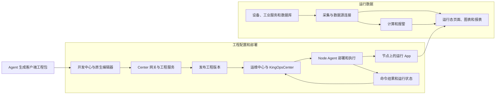

<!-- modified by jinlong.feng at 2026-11-20 KF产品架构导读 -->
# KingFusion 3.6 产品功能与系统架构

KingFusion 3.6（KF）是一套工业数据接入、监控组态和运行管理平台。工程人员接入设备及业务系统的数据，配置计算和报警，制作供操作人员使用的监控页面，并在开发中心发布工程版本。运维人员把发布后的工程部署到运行节点。各类运行 App 分别承担数据读写、脚本计算、告警处理和画面展示。KF 能支撑设备监控、生产总览、告警看板、趋势与报表、能源分析和 3D 场景展示等场景，具体能力取决于工程配置和现场已安装的服务。

本文是产品和代码的入口，供接手人员及后续大模型定位需求。产品结构按工作区代码整理，现场结论按文末的日期和验收范围理解。实现细节见 KF 运行逻辑与阅读路线。

<!-- modified by jinlong.feng at 2026-11-20 开发中心新Agent定位 -->
> **开发中心 Agent 方向（2026-11-20）**　原客户端工程生成 Agent（`agent-app/`）已弃用。下文关于该工作台、工程包生成及验收的内容均为历史记录。新的 Agent 将从头设计，入口设在 KF 开发中心，面向客户提供客户端工程开发指导，并辅助编写能够在 KF 运行的计算脚本。开源框架、MCP 工具和技能仍在选型。运维章节中的 Node Agent 指节点运维代理，继续承担部署和状态上报。
<!-- end -->

## 1. 用户入口与使用者

| 入口 | 谁使用 | 能做什么 |
| --- | --- | --- |
| 开发中心 | 组态工程师、项目开发人员 | 创建和组织工程，配置设备点位及数据源，定义计算和报警，编辑页面、脚本、报表和 3D 资源，导入导出及发布工程。 |
| KF 原生编辑器 | 页面、图形和 3D 场景开发人员 | 从工程页面管理或 3D 资源管理进入，在画布编辑布局、控件、属性、变量绑定及交互。二维页面、图形模型和 3D 场景各有自己的编辑入口。 |
| 运维中心 | 系统管理员、运维人员、有授权的工程用户 | 管理运行节点及 App，部署、重新部署、启停和查看状态及性能，按角色操作采集监视、负载均衡和冷切冗余。 |
| 运行态客户端 | 操作员、值班人员、业务用户 | 打开部署后的监控应用，浏览工程页面和数据，按工程角色使用导航、告警、趋势、报表等交互。 |
| 客户端工程生成 Agent | 希望用文字或参考图构建初版工程的用户 | 在独立工作台讨论或生成方案，经审核后下载可导入 KF 的原生客户端工程包，进入开发中心继续编辑。 |

当前本机 `devFront` 是开发中心 Vue 源码，开发服务默认监听 `127.0.0.1:5175`。登录、工程读取和原生编辑器都连接配置的 KF 后端。本机 `front` 是运维中心 Vue 源码。两套前端的路由、接口、构建产物和使用流程各自独立。 开发中心运行说明 · 仓库入口

## 2. 工程、发布、App 和节点

| 术语 | 在 KF 中的含义 |
| --- | --- |
| 租户 | 服务定位账号、工程目录和权限数据时使用的隔离范围。排查工程时同时确认租户和工程 ID。 |
| 工程组 | 开发态组织同类工程的目录和管理单位。不同模块分别维护自己的工程组。 |
| 工程 | 可编辑的配置和资源集合。五类工程为采集、数据源、计算、报警、客户端，各有业务内容和存储结构。客户端工程可包含页面、变量、数据源引用、资源、权限和脚本。 |
| 发布或更新发布 | 让指定工程版本进入运维可部署的范围。开发中心同时提供离线发布入口，具体可用方式取决于工程类型和版本。 |
| App | 运维中心管理的应用实例。它关联工程、运行节点和实例配置，命令与状态通常按 `appId` 处理。 |
| 部署 | 将发布版本及实例配置送到目标节点，由节点代理准备运行目录和对应服务。 |
| 启动和停止 | 节点代理控制已部署 App 的运行进程，并将实际状态或命令结果上报给 Center。 |
| 运行节点 | 承载 App 的机器。Node 侧代理负责注册、心跳、部署及执行命令。Center 安装树也带有一套运行态文件。 |
| 开发态与运行态 | 开发态编辑和保存工程。运行态加载已经部署的工程和实例配置，解析页面并执行数据订阅、事件和脚本。 |

分析跨模块需求时保留这几个身份的对应关系。一个工程可对应部署配置及 App，运维界面上的 App ID、工程 GUID、节点 ID、用户与租户 ID 分别用于不同对象。修改一个对象的状态前，应确认请求实际命中哪一个对象。

## 3. 五类工程的业务能力

| 工程类型 | 在开发中心配置的内容 | 发布后的用途 |
| --- | --- | --- |
| 数采 | 安装或选择驱动，管理采集设备、点位和变量，配置网络、存储和转发。页面提供 OPC UA、OPC DA 的相应管理和导入导出入口。 | 通过部署环境提供的驱动与设备通信，把点位数据提供给后续工程和采集监视。驱动、原生依赖和协议可用性需要按目标平台验证。 |
| 数据源 | 管理数据连接、连接测试及实时、历史、报警等数据能力。可为支持的工业数据源选择 REST、MQTT 或 Redis 等取数方式，写入方式以可用连接配置为准。 | 部署后的 `kingdbconnector` 连接数据提供方，对使用该源的工程提供对应的读取、订阅或写入能力。源码带有工业实时源、关系数据库、时序库和消息中间件等适配。 |
| 计算 | 配置数据源、全局变量、系统脚本、请求触发、数据变化触发、条件和周期脚本，以及自定义函数和依赖。 | 在运行服务中按工程配置触发计算，用来形成业务指标、状态和规则结果。检查脚本需求时需同时确认触发时机、输入质量和计算输出。 |
| 报警 | 配置报警数据字典、数据源、自定义报警及报警系统参数。 | 运行服务按配置处理报警，客户端或相应数据源可以消费报警结果。阈值、恢复条件、确认及历史能力以所使用的报警模块和接口为准。 |
| 客户端 | 管理页面和页面组、工程变量、数据源、图形模型、报表、脚本、安全对象、国际化翻译和 3D 资源。 | 浏览器加载部署工程，渲染页面与控件，以变量、数据源和事件驱动实时展示与交互。 |

一个典型联动是把设备温度接入采集工程，通过数据源向客户端提供实时值和趋势查询，让计算工程汇总温度指标，报警工程判断超限，再由客户端把监测值、趋势和报警放到同一监控页面。工程相互关联的方式由项目配置、部署及运行服务决定。 开发中心路由 · 数据源选项 · Node 数据源适配目录

## 4. 数据流和部署流程

1. **配置与编辑。** 开发中心从同源入口请求 `/api`，Center 网关把请求交给客户端、数采、数据源、计算、报警等相应服务。工程服务管理工程与工程组、元数据以及页面、变量、脚本和资源等业务文件。导入、导出、复制和恢复等操作继续由相应工程服务处理。
2. **发布与运维。** 发布确定可部署的工程版本。运维中心创建或选择 App，指定运行节点和配置，下发部署、启动、停止或重启等指令。Node Agent 实际执行并回传结果。一个操作可能先返回命令 ID，再由前端轮询或订阅状态。接口受理、命令完成和 App 实际运行分别对应不同的状态。
3. **运行与订阅。** 运行态进程从指定工程目录加载实例和工程配置，浏览器初始化页面、控件、布局、工程变量、数据源和事件脚本。实时值通常沿设备或外部服务、数据源适配、变量订阅、控件更新流转。历史、报警和写入遵循相应接口及权限。
4. **状态与授权。** 运维状态由节点注册、心跳和 App 上报驱动。开发和运维页面根据角色及工程授权显示或启用操作，相应服务在接口层核验权限。运行态还有自己的登录、工程安全对象、连接和授权席位等约束。

项目数据、已发布包、已部署实例目录和前端构建分别保存在对应环境。部署排查应先核对操作对应的工程版本和 App，再核对目标节点、实际加载路径与进程。 运行逻辑 · 五类工程与 App 实际联调

<!-- modified by jinlong.feng at 2026-11-20 跨工程解决方案开发指导 -->
### 4.1 如何沿着一个变量追踪工程关系

下表按 KF 3.6 源码梳理。接口用于说明 KF 各组件怎样协作。开发态路径相对门户的 `/api`，运行态路径属于部署后的服务。具体版本与组态决定一个客户方案实际走哪条路径。

| 追踪的问题 | 开发态怎样建立关系 | 运行态怎样核对 |
| --- | --- | --- |
| 采集点从哪来，哪些数据源可以读到它？ | 数采通过 `GET /collect/variables` 按工程和分组取点表。数据源工程按类型配置连接，`GET /dataSource/getTagList` 用数据源工程 GUID 取点表。沿源类型、目标连接与点名核对。外部历史库或业务数据库也能独立作为来源。 | 分别核对实际采集点值、质量、数据源能否读到该点。数据源运行服务按类型处理实时、历史等请求。实时点出现只证实该点可读，历史趋势还需要历史数据和查询配置。数采接口 · 数据源配置与点表 · 数据源运行接口 |
| 计算脚本用的是哪个来源，结果去哪里？ | 计算工程在数据源管理中选已有数据源，保存工程内名称、连接名称、类型，再在数据字典选取点名。查看脚本的触发类型、输入引用，以及结果是返回给调用方还是写入约定的目标。 | 计算运行服务按配置中的 `serverName` 与租户向 `/ops/accessURL` 查找 App 地址，支持的 KIO、KS 类型再建立点位订阅。节点有独立的周期、数据变化、条件、请求等脚本入口。计算结果要供客户端或报警使用时，应能指明结果的返回路径或对应的可读点位及连接。计算工程数据源管理 · 数据字典选点 · 运行态地址解析与订阅 |
| 报警监视哪个点，客户端又从哪里读报警？ | 报警工程保存的数据源引用含数据源工程 GUID（`dm_guid`）和名称（`dm_name`）。快速添加报警点时还要传报警工程内的 `dataSourceId` 和点名。反方向上，数据源工程选 `AlarmEngineering` 类型时还可选择目标报警工程。报警输入与报警事件输出是两条关系。 | 报警运行服务按名称解析上游 App、订阅点位、处理首次数据及后续变化。客户端可以通过已配置的报警数据源查询缓存或历史报警。上线核对时分别观察输入点变化、报警产生和恢复、客户端报警窗口的事件。报警工程接口 · 报警工程型数据源选择器 · 报警点订阅 · 客户端查询接口实现 |
| 画面上的数值到底绑定了谁？ | 客户端数据源配置分别保存工程内名称和 `appName`、`dataSourceName`。结合工程变量、页面和控件绑定追踪来源。同名点存在于多条连接时，应保留每一级引用。 | Node 客户端的订阅处理使用 App 名、数据源名和帧内点名找到关联变量，再根据初值、值和质量更新变量。排查“画面一直是 0”时，先区分真实零值、无有效初值和控件默认值。客户端数据源配置 · 运行态订阅数据处理 |
| 页面能否主动发起一次计算？ | 对于按需查询，可检查目标计算工程是否定义请求式脚本，约定输入和输出，再查该客户端版本支持的调用方式。 | Node 客户端快照中的 `requestCalculationPost` 先按 App 名解析地址，再向指定路径提交请求。计算服务按路径末段匹配已登记的请求式脚本并处理 `InParam`、`RequestID`。这是可追踪的一条实现路径。面向客户提供可粘贴的调用示例前，还需在对应客户端版本验证函数可见性、通信方式与真实返回值。Node 客户端实现 · 计算请求分派 · 请求脚本与响应 |

一项业务需求可能只用其中几条路径。以供水站为例，实时压力直接供画面与高压报警使用。如果客户还要求过去五分钟的平均压力，应另行约定采样来源、时间窗、坏质量处理和结果去向，再确定是否让报警使用这个平均值。交付时由客户依次核对原始输入、计算输出、报警触发及恢复、画面显示，以及这些结果对应的发布版本与运行 App。样例仅说明方案拆解方法。

### 4.2 开发指导助手的产品边界与验收依据

2026-11-20 确认的方向是从头开发解决方案指导助手，优先接云端模型，模型接口同时考虑客户内网部署。助手面向整个解决方案，客户亲自在 KF 中配置、保存、发布和联调。以下是设计建议，实际接入及运行验收有待实施。

- **入口与上下文。** 建议开发中心提供方案级入口，客户端、计算等模块提供带当前任务的入口，共享同一份方案进度。首版可从客户主动提供的版本、模块、脱敏点表、工程配置摘要、截图和测试反馈建立上下文。云端模型通过 KF 侧服务接收当前步骤所需资料，凭据保留在客户环境。模型提供方可配置，指导所用的产品知识和验收用例独立维护。
- **按交付目标组织步骤。** 先列输入、业务规则与交付画面，再列涉及的工程、引用、发布版本和 App。每一步给出界面入口、所需角色与前提、客户填写的字段、可观察的预期结果，以及结果不符时回查哪一层。保留当前步骤和客户已经核对的事实，方便从计算编辑器回到整个方案。
- **逐条核验依据。** 可将版本化操作手册、双端实现和独立测试环境验收过的标准方案纳入知识库。用于检索资料和追踪引用的 MCP 工具处理这些材料。技能描述开发方法。确定性函数核对字段、类型、函数签名、输入输出及覆盖的测试用例。模型产生的候选步骤和脚本都需经过相应的校验。
- **区分能作出的结论。** 源码能解释调用关系。可复现的版本验收记录能支持相应步骤和边界条件。客户现场完成某一步依赖其实际回报的可观察结果。缺少决定性信息时，应明确询问具体版本、绑定或结果。新组合和新脚本先标记待验证，附样例输入、期望输出及异常情况，取得对应证据后再给结论。

例如，2026-11-11 的记录验证了五类工程和 App 的权限、发布及启停，数采订阅用的是测试工程的空变量列表。本轮依据本地接口和运行实现追踪上述关系；端到端业务样例仍需在匹配版本的独立参考环境取得结果，客户现场的点值与设备行为另由客户核对。已有验收的具体范围
<!-- end -->

<!-- modified by jinlong.feng at 2026-11-20 供水站压力监控开发指导方案 -->
首个指导案例已整理为供水站压力监控开发与联调方案，含从空工程到发布的客户步骤、均压脚本、报警边界、验收用例和助手工具分工。
<!-- end -->

<!-- modified by jinlong.feng at 2026-11-20 开发助手个人记录归属 -->
### 4.3 方案清单与对话历史的归属

已确认的产品决定是按登录 KF 开发中心的开发人员账号保存方案清单和对话历史。同一开发人员切换工程入口或再次登录，可以继续自己的记录。两位开发人员即使有权打开同一个工程，也分别维护各自的方案清单和聊天记录。读取方案中引用的工程时，按当前账号当时的 KF 权限检查。

同一账号下，一个方案可以关联多段对话。例如，开发人员从计算编辑器讨论结果变量，再从客户端编辑器打开同一方案，可以继续原对话，也可以新开一段讨论画面绑定。各段对话共用该方案已确认的清单，并各自保留讨论过程。

| 记录 | 保存或更新时机 | 在后续对话中的用途 |
| --- | --- | --- |
| 对话历史 | 助手自动保存开发人员的提问和助手的答复。 | 可回顾讨论过程、候选做法和选择理由。 |
| 方案清单 | 助手根据讨论整理拟新增、修改或移除的内容，展示给开发人员。开发人员确认后，变更才写入清单。 | 各工程入口以最近确认的清单为共同依据。尚待确认的提议在续聊时仍标为待确认。 |

开发人员确认将一项工作纳入方案，表示采纳这个决定。该工作在 KF 中的配置、发布和运行结果，仍需对应的工程记录或客户反馈才能标为已验证。
<!-- end -->

<!-- modified by jinlong.feng at 2026-11-20 KF开发助手按需查询设计 -->
### 4.4 自动识别工程与按需读取

已确认采用当前入口自动识别工程、按用户问题读取相关配置的方式。引用在 KF 侧解析，模型按需取得回答所需的字段、相关路径和证据；通用操作问题可以只查对应版本的产品知识。从方案续聊时沿用当前账号已确认的清单。全开发态的只读 MCP、技能、校验函数与验收设计
<!-- end -->

## 5. 关键子系统

### 客户端页面和 3D

客户端工程的页面和图元会被序列化为 KF 原生工程对象。开发态从页面模型和控件属性恢复编辑画布，运行态从部署工程恢复并执行页面。二者涉及同名 Common 控件代码，开发态、Center 运行态、Node 运行态分别加载各自安装目录中的实现。控件外观或行为的变更应沿「模型字段 → 属性恢复 → 控件 DOM 或画布 → 容器布局 → 数据绑定或脚本」检查实际消费者。父子布局的坐标、尺寸策略、页面默认入口和 GUID 引用是容易影响兼容性的部分。

原生二维编辑器运行在 `/kingclient/`。3D 模型通过客户端工程的 3D 资源管理进入，入口会带上工程和场景上下文。3D 子页使用 `/kingclient3d/` 及 `kingtopo` 服务，Socket.IO 使用单独的 `/socket.io/` 路径。页面 HTML 正常返回、模型资源读取、WebSocket 升级和模型在画布中渲染分别可以独立验证。 客户端入口及运行态代码 · 3D 资源入口组件

### 运维权限、负载均衡和冗余

运维中心管理节点和 App，显示状态、性能与日志，提供部署、批量启停等功能。按钮显示、接口鉴权、异步命令归属和状态查询是同一流程的不同环节。当前 JSON 权限版根据角色、租户、工程创建者或共享关系判断访问。该版中管理员与二级管理员可运维本租户各工程，普通用户在其受权范围内操作 App。部分状态和性能查询按独立只读规则处理，既有页面按工程权限过滤可显示的 App。变更权限需同时检查直接 API 与页面，以及撤权后的列表和随后的命令查询。 当前权限版本 · 批量命令与采集监视联调

现有工作区提供负载均衡与节点冷切冗余入口。已记录的冷切设计由两台节点及各自的受管 App 清单组成。配置生效后，激活端运行其受管 App，失活端保持停止。Center 汇总健康状态与事件，由用户发起切换并查看逐 App 的执行结果。节点恢复、强制切换和部分失败各有状态约束。功能入口还受角色、功能开关和实际部署版本影响。 冷切冗余设计 · 运维中心路由

### 认证与支撑服务

Nginx 提供浏览器入口及反向代理，开发态 Gateway 分发业务请求。Center 的 `kingoauth` 提供身份、用户与会话服务，`kinglicense` 与产品授权链有关，`kingservicediscovery` 提供服务发现，`kingfileserver` 提供文件传输，`kinglogserver` 提供日志服务，`kingtileserver` 提供瓦片相关服务。服务是否安装、监听在哪里、如何认证以及许可证能力，以目标环境的配置、运行进程和版本为准。排查连接问题时先确认访问的是开发态登录、运维登录、运行态会话还是某个子服务的连接。

### 客户端工程生成 Agent

Agent 的 Web 工作台接收文字和参考图，API 管理会话、任务和审核，Worker 与编排器处理生成及构建。`domain-client` 根据 KF 原生约束把方案转为页面、控件、布局和资源，校验后交付工程包。用户在 KF 开发中心导入交付包，使用原生编辑器检查和继续开发，随后按 KF 工程流程发布。

目前有文字生成、文字工程续改、单图识别审核、蓝图确认、历史版本下载和分叉的验收记录。三份最终样例通过原生导入、逐页读回和开发态打开。完整运行态发布、真实业务数据绑定和图片精细还原仍有各自的待验收范围。Agent 的功能范围以其能力注册、生成与编译代码和验收记录为准。 Agent 当前可用版 · Agent 验收范围

## 6. 代码和需求定位

| 需求或故障 | 第一落点 | 继续检查的边界 |
| --- | --- | --- |
| 开发中心菜单、工程列表、管理表单、CSV 导入入口 | `devFront/src`，先看 `router/asyncRoutes.js`、`views/Main`、`api/allRequest` | Gateway 对应转发模块、业务服务输入校验及错误码。例如数采 CSV 由开发前端、`CollectService` 与 `kingioserver` 一起消费。 |
| 客户端画布交互、页面属性、图形模型、报表与脚本 | Center 开发态 `kingclient/exe`，先看 `views`、`extension`、`DevelopClient`、`Common`、`lib/model` | 编辑器保存出的工程结构，以及 Center 与 Node 运行态加载相同结构的结果。 |
| 3D 模型打开、场景对象、WebSocket | 开发中心 3D 资源视图 与 `kingtopo` | 入口参数、工程场景资源、Nginx 的 `/kingclient3d/` 和 `/socket.io/`、客户端初始化与画布。 |
| 运行画面、数据刷新、事件脚本、连接和授权席位 | Node 运行态客户端 与 Center 运行态客户端 | 实例配置、项目加载、`RunClient`、`Common`、用户会话和数据订阅。确认现场实际使用哪套运行态。 |
| 设备读取、数值质量、断线与重连 | Center 数采工程服务、Node 或 Center 的采集运行程序、`kingdbconnector` | 设备到采集服务、采集到数据源、数据源到浏览器是不同连接。核对来源、值、质量码、订阅初值及恢复推送。 |
| 数据源连接、数据库查询和写入 | Center `kingdbmanager` 的工程配置与 DAO，运行态 `kingdbconnector` 的适配 | 连接测试、部署后的连接配置、适配器行为和最终使用该源的 App。 |
| 计算规则和报警策略 | Center `kingcalculation` 与 `kingalarm` | 对应运行服务、实际触发、数据质量和结果消费者。 |
| 部署、启停、状态、负载均衡及冗余 | `front/src` → Center 运维后台 → Node Agent | 请求身份、目标 App、命令状态、节点执行结果及上报。涉及切换时核查两侧角色和受管 App。 |
| 用户角色、共享、项目权限、SSO | `kingoauth`、开发网关 和各业务服务的鉴权 | 先判断作用于开发态、运维态还是运行态，再核对租户、真实身份、角色及工程授权来源。 |
| 文字或图片生成、工程包兼容、历史版本 | `agent-app/apps`、`agent-orchestrator`、`domain-client` | 生成合同、KF 原生字段、包校验、真实导入和目标环境的实际渲染。 |

仓库有本机私有安装树、脱敏源码快照和不同版本的现场补丁。定位功能时先看 `kf-reference` 的原路径，修改或部署前再与目标环境的实际加载文件比对。控制台、Node 日志、接口响应、工程文件和浏览器画布各自回答不同的问题。交付和注释遵循 项目开发约定。 参考快照范围

## 7. 版本与验收基线

| 日期或范围 | 已确认的结论 | 边界 |
| --- | --- | --- |
| 2026-11-11，3.32 权限联调 | 工程权限来源恢复为原工程 JSON，保留运维权限和首次登录列表修复。五类独立测试工程和对应 App 验证过发布、部署、启停及批量命令轮询。 | SQLite 权限库与 KingMigration 属于已封存的版本。该轮验收集中在权限、状态和命令链路。 实际联调 |
| 2026-11-19 至 2026-11-20，本地开发态前端 | `devFront` 从开发态源码及同批资源恢复，可安装、启动、构建并登录真实 KF。二维实测打开全控件验收工程，画布、控件库、对象树及属性面板可用。 | 本次二维检查覆盖打开和读取。工程保存、发布、部署以及其他业务模块有各自的验收路径。 本地启动说明 |
| 2026-11-20，3.32 的 3D 编辑器 | 修复服务器 Nginx 的 Socket.IO 升级配置后，服务器直连和浏览器握手返回 HTTP 101。用未发布测试工程 `test_最新_2` 实际加载了 `wzl1`，画布显示模型，列表有 8 个对象，退出后场景文件哈希一致。 | 自动打开或刷新时曾出现 `updateUrl` 错误及空画布。在编辑器左侧双击同一场景可加载。该现象仍需独立定位。 |
| 2026-10-27，Agent | 通过文字生成、文字续改、参考图审核和工程包构建下载，三份样例在 KF 开发态导入与打开。 | 真实业务源和完整发布后的运行行为仍需单独验证。 Agent 验收记录 |
| 2026-10-29，独立部署审计 | 快照提供参考源码、静态依赖和脱敏配置样例。 | 从仓库独立搭建完整 KF 仍需要原生依赖、私有运行配置、工程初始化、完整服务栈与有效授权，独立启动尚未验收。 Linux 和 Docker 启动审计 |

休眠重连与 KIO 掉线属于有独立适用范围的运行态补丁。需求涉及浏览器唤醒、授权占位、连接质量或无效值显示时，先核实现场部署的版本和适配条件，再参考 运行态休眠候选说明 与 KIO 掉线补丁说明。

## 8. 讨论新需求时确认的内容

围绕实际业务流程讨论。先讲清楚谁在什么入口、对哪个工程或 App、在什么条件下要完成什么动作，然后描述成功时页面、数据或运行状态的变化。以这个流程定位应修改哪层，并决定在哪个环境如何复现和验收。

| 需要确定的事项 | 说明 |
| --- | --- |
| 人和入口 | 用户角色、开发中心、原生编辑器、运维中心、运行画面或 Agent 工作台。 |
| 业务对象 | 工程类型、工程或 App、涉及的页面、设备变量、数据源、节点或发布版本。 |
| 触发与结果 | 什么动作或事件触发，数据从哪里来，成功后页面或运行状态应如何变化。 |
| 配置与权限 | 谁能查看、配置、操作或审批，配置只影响新工程还是也作用于已有工程。 |
| 部署与验收 | 目标平台和版本，需要真实设备、模型、项目样例或节点联动时，选定对应的测试环境和最小验收路径。 |

按场景选取验证路径。编辑能力从原生打开和保存验证到运行态读回，数据能力从数据源或设备验证到界面消费，运维能力从请求受理验证到节点实际执行和状态回传，跨角色能力用允许和拒绝两类真实流程验证。
<!-- end -->
