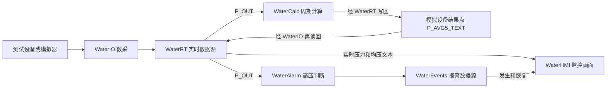

<!-- modified by jinlong.feng at 2026-11-20 供水站压力监控开发指导方案 -->
# KF 供水站压力监控｜从空工程到发布联调

本方案供两类读者共用。组态工程师按第 1～4 节在 KF 完成配置和联调，助手开发人员按第 5 节实现同一套指导。交付结果是一张能显示**出站实时压力、最近五次分钟采样均压、实时高压报警**的运行画面。客户亲自操作开发中心、运维中心和模拟器。助手解释步骤、检查客户提供的脱敏材料和计算预期值。

<!-- modified by jinlong.feng at 2026-11-20 供水站压力监控实机联调 -->
**适用基线。** 依据工作区 KF 3.6 开发态和 Node 运行态源码。参考路径选用 Linux KIO、工业数据源网络模式、RESTful 查询与结果写回、MQTT 实时发布。目标节点应具备相应采集驱动、消息服务、授权和支持读写的模拟设备。现场若使用 Windows 原生 KIO、历史库取平均或其他数据源，需要匹配该版本的操作说明与样例。2026-11-11 的真实环境记录覆盖五类工程发布、部署及启停。本案例的逐段实测结果、运行实例、环境修正和剩余验收项见供水站实机联调记录。已有联调范围
<!-- end -->

## 1. 先约定交付结果和对象

本例的数值、名称和时间参数供**测试台**复现。正式站点的压力单位、采样规则和报警限值由客户工艺负责人确定。所有模拟压力用 kPa 表示，一次换算即可。结果写回仅指模拟器中专设的显示结果寄存器。

| 项目 | 本案例采用的约定 | 可观察的结果 |
| --- | --- | --- |
| 实时压力 | 一路出站压力，测试量程 0～1000 kPa。原始值与展示值均为 kPa。 | 模拟器给 500，采集监视和运行画面均显示 500 kPa。真实零值可显示为 0。 |
| 五分钟均压 | 每分钟固定时刻取一个有效样本，取当前分钟及此前四个连续分钟的算术平均。五个样本全部有效才给数值，保留一位小数。重启从空窗口开始。 | 同一份样本多人手算结果一致。坏质量、过期值、缺一分钟或重启预热期呈现“样本不足”。 |
| 高压报警 | 只启用原始压力的“高”限，测试限值 600 kPa。本例死区和延时为零，关闭高高、低和低低。 | 从 599 升至 600 时触发，保持 600 时仍处于高报，回到 599 时恢复。确认与恢复分别观察。限值计算实现 |
| 显示与失效 | 实时压力显示数值和单位。均压使用一个可写的**模拟字符串点**，同时带结果或原因、截止时间。时间以 UTC 表示，屏上注明。 | 正常可见 `AVG5=520.0 kPa` 和时间。写回链路中断可能留下旧文本，客户端旁注明“截止时间超过 90 秒即过期”，验收人员按截止时间判读。 |

### 工程与数据流

新建五类、共六个工程。为便于核对，按下表命名。每创建一项，在记录表中填入系统生成的工程 GUID。部署时再填实际 App 名和 App ID。默认 App 名通常取发布工程名，引用以目标环境实际值为准。运维中心选取已发布工程的实现

| 工程名 | 类型 | 本方案中的用途 |
| --- | --- | --- |
| `WaterIO` | 数采 | 从测试设备读取数值点 `P_OUT`，开放一个仅供显示结果的模拟字符串点 `P_AVG5_TEXT`。 |
| `WaterRT` | 数据源 | 接入 `WaterIO` 的实时服务，向计算、报警和客户端提供点值或订阅。 |
| `WaterCalc` | 计算 | 使用工程内数据源别名 `Rt` 访问 `WaterRT`，每分钟采样，把带时间的结果写回 `P_AVG5_TEXT`。 |
| `WaterAlarm` | 报警 | 订阅 `WaterRT` 的 `P_OUT`，判断高压和恢复。 |
| `WaterEvents` | 数据源 | 类型选“报警工程”（`AlarmEngineering`），目标选 `WaterAlarm`。为客户端报警窗口提供事件。 |
| `WaterHMI` | 客户端 | 通过 `WaterRT` 显示两个点，通过 `WaterEvents` 显示报警。 |



## 2. 客户从空工程开始怎样做

每步最后一行列出助手使用的 MCP 工具、技能和普通函数，均为**待实现能力**。名称和输入输出见第 5 节。“发布并启动某个工程”统一使用步骤 03 的做法。先把上游运行起来，后续工程才有真实点表和数据可选。

### 01　确认测试条件和验收口径

记录开发中心构建版本、节点操作系统与运行版本、目标租户、测试节点及其时区。准备可创建及发布这六个工程的账号、可部署测试节点的运维人员、可在模拟器上设压的测试人员。确认模拟源能持续刷新时间戳、能产生一次坏质量、能读写至少 64 个 ASCII 字符的结果点。准备本部署使用的 KIO 实时接口地址、MQTT 服务及主题。密码在客户环境中填写。

**通过**　客户能登录两个中心，看到目标在线节点和所需模块。点表记录压力单位、数据类型、设备地址、读写方向、质量及时间表示。**未通过**　缺驱动、节点不在线、质量不可控或缺连接资料时，标出受阻项及负责人。允许先做离线样本演算。

助手使用 `lookup_kf_reference`、`inspect_case_material`，技能“方案建档”，函数 `checkProfile`。

### 02　建立采集工程和两个测试点

开发中心 → 数采管理，按测试节点平台新建 `WaterIO`。在设备配置中选择本机已安装、与模拟器匹配的驱动，按模拟器实际协议、地址和采集周期建立设备。在采集变量中创建 `P_OUT`（数值、输入、kPa）和 `P_AVG5_TEXT`（字符串、可读写、初始可空）。使用该驱动真实的寄存器映射。记录接入方式、两个寄存器及类型，并核对实时发布主题。模拟器在每次采样前更新输入及其采集时间戳，压力保持恒定时也应能验证数据新鲜度。

**通过**　保存并重开仍能看到正确的两个点。点地址各自独立，结果点对应模拟存储区，字符串可完整保存本例文本。**未通过**　若文本被截断或设备只支持数值寄存器，该驱动不满足本例接口约定，先调整测试设备映射。采集设备与变量路由 · 寄存器与读写属性

助手使用 `lookup_kf_reference`、`inspect_case_material`，技能“采集与数据源”，函数 `checkPointTable`。

### 03　发布上游并建立 App，确认采集真实出值

在数采工程列表单选 `WaterIO`，点“发布”。到运维中心选择测试节点，进入该节点的 App 管理，新建 App，在工程选择器选刚发布的 `WaterIO`。核对类型、工程 GUID、节点和可用端口，保存、部署、启动。记录 App ID、名称、发布标识和命令最终结果。版本界面若没有修订号，记录发布时间并关联本次工程导出摘要。对后续五个工程重复此过程。部分页面把部署和启动呈现为独立操作，应分别观察最终状态。

**通过**　发布工程可选、节点部署完成、App 运行。客户在模拟器把压力从 450 改为 500，运维的采集数据监视在同一点看到两个值和对应质量。将一段已知文本写入模拟结果寄存器，可从采集端原样读回。**未通过**　工程不可选查租户、授权和发布状态。命令受理后仍查最终状态及节点日志。运行却无值，先核对驱动、寄存器、比例与采集周期。开发中心发布与更新 · 部署、启停和命令查询

助手使用 `lookup_kf_reference`、`inspect_case_material`，技能“发布与联调”，函数 `checkDeployment`、`compareEvidence`。

### 04　建立实时数据源，验证读、写、订阅三条链路

<!-- modified by jinlong.feng at 2026-11-20 供水站压力监控实机联调 -->
在 Linux KIO 实测中，采集端 MQTT 的 Broker 地址填写 `主机:端口`，实时数据源的发布主题填写消息服务实际收到的主题。此驱动的亚控格式主题为 `datachange_S_KIOL_<采集工程GUID>`。把工程中另填的自定义订阅主题误当成发布主题时，REST 仍可读值。验收订阅时应在运行客户端或数据源 WebSocket 上看到设压后的新样本。
<!-- end -->

在数据源管理新建 `WaterRT`，类型选“工业数据源_网络模式”，数据来源选 `KingIOServerLinux`。本例选 RESTful 获取变量和写回，在表单中填写实际 KIO 接口、采集工程 ID、运行实例名、实时变化发布主题及匹配的 MQTT 连接。先保存，再按步骤 03 发布、部署和启动。类型及接入选项 · 数据源表单

**通过**　① 目标数据源点表能找到两个点。② 客户通过本版提供的数据源读值界面或已授权的测试客户端读到 `P_OUT` 的点名、值、质量和采集时间。③ 经该数据源对模拟结果点写入 `CHECK-01`，从采集监视读回同一文本。④ 改动模拟压力后，订阅端收到新值。若门户只显示点表，可在步骤 05 的测试计算脚本中读写，在步骤 08 的运行画面补做订阅观察，将对应项保持待验。**未通过**　查询失败先查 RESTful 地址和实例，查询成功但订阅无变化查主题、消息服务和订阅配置。总体写入成功还需核对实际回读。Linux KIO 读写适配

助手使用 `lookup_kf_reference`、`inspect_case_material`、`trace_case_binding`，技能“采集与数据源”，函数 `checkPointTable`、`checkBindings`。

### 05　建立计算工程，验证压力怎样成为均压

在计算管理新建 `WaterCalc`。数据源管理中将 `WaterRT` 加入，工程内名称填 `Rt`。本例按点名调用函数，输入读取质量和采集时间一并参与判断。在“周期性脚本”新建 `PressureAverage`，固定周期 1 分钟，设置生效、无限次、无结束时间，起始时间选整分钟后 30 秒。模拟器在每个采样分钟前半段更新，建议在第 20 秒前后送值。正文使用第 3 节候选脚本，保留编辑器已有外壳。保存、重开核对，再发布、部署、启动。首先获取测试点一条好质量样本及一条坏质量样本，核对第 3 节所列输入约定。

**通过**　脚本日志可按工程、脚本名和时间对齐。每分钟模拟结果寄存器出现新的截止时间，前四次为样本不足，第五次见约定均压。**未通过**　若源码案例的质量或时间表示与目标版本不同，先取得脱敏返回样例调整适配并重测。没有结果时按触发设置、运行 App、`Rt` 指向、读返回、写入和寄存器回读顺序检查。周期设置 · 运行时钟与触发 · 计算 App 查找数据源服务

助手使用 `lookup_kf_reference`、`inspect_case_material`、`trace_case_binding`、`check_case_sample`，技能“计算脚本开发”，函数 `checkBindings`、`checkScriptContract`、`evaluateWindow`。

### 06　建立报警工程，验证原始压力触发与恢复

在报警管理新建 `WaterAlarm`。报警工程的数据源管理选择 `WaterRT`，在数据词典从该源选择数值点 `P_OUT`。打开该点报警属性，启用报警、限值报警和“高”，限值 600，填写可辨识的报警文本，如“出站压力高”，按测试约定选优先级。本例使用无死区、无延时的配置，只开启这一级。在系统配置按现场部署填写报警消息服务，检查 MQTT 连接。需要配置历史库的部署使用专用测试库。按步骤 03 发布、部署、启动。

**通过**　重开词典可看到原始点、正确源和限值。运行后按 `599 → 600 → 601 → 600 → 599` 逐个送值，每次等待采集和订阅处理完成。在报警事件观察端看到一次发生、一次恢复，时间和点名对应。若尚无事件观察端，步骤 08 完成后从头重放。**未通过**　采集正常但无报警，查词典源、点类型、三个启用项、当前加载的发布版本。报警侧有事件但画面无事件，转步骤 07、08。报警数据源及词典接口 · 高限配置界面 · 报警系统连接配置

助手使用 `lookup_kf_reference`、`trace_case_binding`、`check_case_sample`，技能“报警与画面”，函数 `checkBindings`、`evaluateHighAlarm`。

### 07　建立供画面读取报警事件的数据源

回到开发中心的数据源管理，新建第二个数据源工程 `WaterEvents`，类型选“报警工程”，在下拉表中选 `WaterAlarm`，保存并按步骤 03 发布、部署、启动。此处选择的是产生事件的报警工程。步骤 06 选择的 `WaterRT` 是给报警判定提供输入的实时源。

**通过**　重开 `WaterEvents` 仍指向 `WaterAlarm`，运行配置解析到目标报警实例，报警消息连接成功。在步骤 08 打开事件窗口时可同时验证初始状态和后续新事件。**未通过**　目标不在下拉表先核对报警工程是否已建立、租户及可见权限。事件不刷新时核查报警端 MQTT 配置、实例关联及订阅。报警型数据源选择器 · 报警事件适配及首次订阅

助手使用 `lookup_kf_reference`、`trace_case_binding`，技能“报警与画面”，函数 `checkBindings`、`checkDeployment`。

### 08　建立客户端监控画面

<!-- modified by jinlong.feng at 2026-11-20 供水站压力监控实机联调 -->
如果用二维页面周期脚本给原生 Label 设置文本，从 `$System.P_OUT` 和 `$System.P_AVG5_TEXT` 取工程变量，再调用控件的 `setText`。在本次实机上改用 `$Variable` 会得到 `undefined`。首次订阅可能尚在加载，验收时改变模拟输入并等待新点值到达。原生报警窗中恢复记录可以保留为绿色行，核对“事件类型”、事件时间和报警服务当前活动数即可识别恢复。
<!-- end -->

在客户端管理新建 `WaterHMI`。在数据源管理加入 `WaterRT`、`WaterEvents`，建议工程内分别命名 `Rt`、`Events`。在工程变量中从 `Rt` 映射数值点 `P_OUT`、字符串点 `P_AVG5_TEXT`。在页面管理新建 `StationMain`，打开二维编辑器，放置压力数值显示并标明 kPa，放置均压字符串显示及 UTC 过期说明，放置实时报警窗口并选 `Events`。允许显示本次的报警组和优先级。保存页面并设为默认页。

**通过**　重开编辑器，两个显示对象仍关联对应类型的工程变量，报警窗口仍指向 `Events`。按步骤 09 打开运行画面后，将压力从 480 变为 510，两个观察端对得上；均压按分钟更新；发生、恢复从报警数据源进入事件显示。实时窗口如只保留活动报警，恢复后应移出活动列表，恢复事件另用事件记录或日志核对。**未通过**　运行页面首屏不对查默认页。单个对象不动查该控件绑定，全部点不动查运行客户端的数据源和订阅。通过数据源名、App 名和点名一起消除同名点歧义。客户端变量与数据源 · 默认页管理 · 客户端订阅帧更新变量

助手使用 `lookup_kf_reference`、`inspect_case_material`、`trace_case_binding`，技能“报警与画面”，函数 `checkBindings`、`compareEvidence`。

### 09　发布客户端并核对整套运行版本

单选 `WaterHMI`，发布到运维可选的工程列表。在目标节点按步骤 03 创建、部署、启动客户端 App，通过客户浏览器打开该 App 实际运行地址。清点六个工程和六个 App。建议启动顺序为 `WaterIO → WaterRT → WaterCalc / WaterAlarm → WaterEvents → WaterHMI`，其中计算和报警均依赖实时源，可分别启动。逐项记录发布标识、节点、端口、实例名、运行状态和时间。

**通过**　客户端从运行地址打开默认页。每条依赖两端实际运行的实例、数据源别名、点名及版本一致。**未通过**　若新配置在编辑器可见而运行画面仍旧，检查是否已更新发布，以及运维实例是否已按该版本重新部署并成功启动。更新后复测受影响的上游、当前模块和下游。变更前保留可恢复的工程导出和对应运行配置。发布更新接口 · App 选择工程及节点

助手使用 `inspect_case_material`、`trace_case_binding`，技能“发布与联调”，函数 `checkDeployment`、`checkBindings`。

### 10　按测试矩阵联调，由客户签收

先执行第 4 节的正常、报警、失效、恢复和重启用例。各行记录输入时刻、实际原始值与质量、均压结果和截止时间、报警事件和画面表现。失败时记录首次出现差异的层级，修正后重跑该用例及相邻用例。最后请另一位工程师从空工程仅按本文复现一次，记录需要追问或修订的步骤。

**通过**　所有必测用例留有目标版本的实际观察证据，影响范围内的复测通过，客户和复核人签字。某个用例无法制造输入时，填写“未验证”和缺少的条件。保存模拟器点表、六项版本映射、计算正文版本、按时间对应的日志或截图及验收表。首次测试完成后由客户恢复模拟器测试初值。**未通过**　保留最后一个已知正确步骤和实际失败记录，沿对应的引用或数据路径复查。

助手使用 `inspect_case_material`、`check_case_sample`、`trace_case_binding`，技能“发布与联调”，函数 `evaluateWindow`、`evaluateHighAlarm`、`compareEvidence`、`summarizeCoverage`。

## 3. 周期脚本参考正文

<!-- modified by jinlong.feng at 2026-11-20 供水站压力监控实机联调 -->
这是供步骤 05 验证的参考正文。计算运行时提供 `KIOQueryDatas(别名, 点名数组, 结果数组)`、`KIOUpdateDatas(别名, 写入对象数组, 错误数组)`。当前实现的写接口总返回码与模拟寄存器读回须分别核对。Linux RESTful 适配把输入映射为 `N/V/T/Q`。本样例以**好质量为数值 192、压力为有限数值或数值字符串、时间为 Unix 毫秒、带明确时区的 ISO 时间，或已核实 UTC 偏移的 KF 本地毫秒时间**为接入约定。样例中 `sourceUtcOffset` 取自本轮节点与 UTC 的实测对照。其他站点须按采集源校时；使用夏令时的站点应提供带偏移的源时间或按其时区规则转换。秒级时间与其他质量编码需以现场样本确定转换规则。不要用浏览器的默认时区猜测源时间。计算函数签名 · 计算读写实现 · Linux 数据源字段映射
<!-- end -->

每分钟第 30 秒采样，源时间应在同一分钟内，且相对采样时刻不超过 20 秒。窗口按采样分钟编号，重复触发只采一次，缺分钟或坏质量均计作缺样。结果文本的时间为**本次计算时间**。同一数值连续出现，只要源样本正常刷新，仍属于有效采样。

```javascript
// modified by jinlong.feng at 2026-11-20 供水站压力监控开发指导方案
const source = "Rt";
const inputTag = "P_OUT";
const outputTag = "P_AVG5_TEXT";
// modified by jinlong.feng at 2026-11-20 供水站压力监控实机联调
// 无时区的设备时间需要现场校时。此测试台已核实为 UTC+08:00。
const sourceUtcOffset = "+08:00";
// end
const now = Date.now();
const minute = Math.floor(now / 60000);
const stateKey = "waterStationPressureWindowV1";
const state = global[stateKey] || (global[stateKey] = {
  busy: false, lastMinute: null, samples: new Map()
});

if (state.busy || state.lastMinute === minute) return;
state.busy = true;
try {
  if (state.lastMinute !== null && minute < state.lastMinute) state.samples.clear();
  state.lastMinute = minute;
  for (const slot of state.samples.keys()) {
    if (slot < minute - 4) state.samples.delete(slot);
  }

  const rows = [];
  const code = await KIOQueryDatas(source, [inputTag], rows);
  const row = rows.length === 1 && rows[0];
  if (code === 0 && row && row.N === inputTag && row.Q === 192) {
    const raw = row.V;
    const value = typeof raw === "number" ||
      (typeof raw === "string" && raw.trim() !== "") ? Number(raw) : NaN;
    let stamp = NaN;
    if (typeof row.T === "number" && Number.isInteger(row.T)) stamp = row.T;
    if (typeof row.T === "string" && /(?:Z|[+-]\d{2}:\d{2})$/i.test(row.T)) {
      stamp = Date.parse(row.T);
    }
    // modified by jinlong.feng at 2026-11-20 供水站压力监控实机联调
    if (typeof row.T === "string" && /^\d{4}-\d{2}-\d{2} \d{2}:\d{2}:\d{2}\.\d{3}$/.test(row.T)) {
      stamp = Date.parse(row.T.replace(" ", "T") + sourceUtcOffset);
    }
    // end
    const age = now - stamp;
    if (Number.isFinite(value) && value >= 0 && value <= 1000 &&
        Math.floor(stamp / 60000) === minute && age >= 0 && age <= 20000) {
      state.samples.set(minute, value);
    }
  }

  const values = Array.from(state.samples.values());
  const result = values.length === 5
    ? "AVG5=" + (values.reduce((sum, value) => sum + value, 0) / 5).toFixed(1) + " kPa"
    : "WAIT " + values.length + "/5";
  const text = result + " | " + new Date(now).toISOString();
  const writeCode = await KIOUpdateDatas(source, [{ N: outputTag, V: text, Q: 192 }], []);
  if (writeCode !== 0) throw new Error("P_AVG5_TEXT write code " + writeCode);
} finally {
  state.busy = false;
}
// end
```

普通读错误码、未知质量和过期样本进入 `WAIT` 分支。底层调用抛出异常或结果点也断连时，本次文本可能无法送达，观察计算日志与上一条文本的截止时间。窗口保存在计算 App 进程内，重启后逐分钟重建。若客户要求断电后仍能立即给出过去五分钟均压，需要改为经验证的历史查询方案。

**怎样取得质量和时间样例。** 客户可先在测试计算工程单独建一次性周期脚本，执行下列诊断正文。一次给好质量，再用同一步骤给坏质量，核对两条脚本日志。记录实际点名、字段值及类型、源时间与节点当前时间的差值。若源端只在数值变化时更新时间，需与客户重新确定“数据新鲜”的判据。诊断完成后停用此脚本，保存或更新发布时把最终配置一并记入清单。Trace 日志去向

```js
// modified by jinlong.feng at 2026-11-20 供水站压力监控开发指导方案
const rows = [];
const readCode = await KIOQueryDatas("Rt", ["P_OUT"], rows);
const sample = rows[0] || {};
Trace(JSON.stringify({
  readCode, name: sample.N, value: sample.V, quality: sample.Q,
  qualityType: typeof sample.Q, sourceTime: sample.T,
  timeType: typeof sample.T, observedAt: new Date().toISOString()
}));
// end
```

## 4. 联调用例与签收表

每轮使用独立测试点。除特意制造的异常外，输入均为好质量、新时间戳；在每分钟第 20 秒左右设值，第 30 秒采样。报警边界试验可以在同一分钟内分多次送值，每次等上一笔传播完成。开启多个用例前明确是否需要重启计算 App 或等旧样本滑出窗口。

| 用例 | 客户输入与操作 | 对照结果 | 查证位置 |
| --- | --- | --- | --- |
| A　首屏与数据连通 | 先给 450，再给 500，打开已部署的客户端默认页。 | 原始压力随输入变化、单位为 kPa；初次计算输出含实际 UTC 时间。 | 模拟器、采集监视、客户端 |
| B　预热与滚动 | 从空窗口依次每分钟给 420、480、540、600、560、500。 | 前四次为 `WAIT 1/5` 至 `WAIT 4/5`。第 5 次为 520.0，第 6 次为 536.0 kPa。600 的单点也可触发高报。 | 计算输出、结果寄存器、客户端均压文本 |
| C　高报边界 | 从正常态依次给 599、600、601、600、599。 | 仅一次高报发生、一次恢复；等于 600 时持续高报。压力在高报状态时若操作确认，确认应独立于值恢复。 | 采集点、报警事件时序、客户端活动报警 |
| D　有效零值 | 空窗口依次给 0、500、500、500、500。每次使用新鲜采样。 | 第五次为 400.0 kPa；相同数值的不同分钟样本和真实零值均参与计算。 | 计算日志或样本记录、结果寄存器 |
| E　坏质量与恢复 | 空窗口依次给 500、500、坏质量、500、500，后续再给三次有效 500。另重跑一次，用过期时间替代坏质量。 | 第五次 `WAIT 4/5`；第六、七次仍为 `WAIT 4/5`；第八次坏样本滑出，恢复为 500.0。 | 质量与源时间、计算输出、画面 |
| F　漏采与重启 | 满窗口后使一次周期没有执行，随后恢复。另一次在满窗口时重启测试计算 App。 | 漏采后的下一次只有四个有效分钟，需要再积满。重启后的第一次为 `WAIT 1/5`，第五个连续有效分钟重新给出数值。 | 触发日志、App 启动时间、带时间的结果文本 |
| G　写入或链路中断 | 在测试台暂时阻断结果点写入，保留压力输入，再恢复。另验证断开并恢复模拟源连接。 | 写入失败可定位到计算错误或明确的读回失败，旧文本时间停止推进。超过 90 秒依照页面说明判为过期。恢复后出现新时间戳。记录本部署原始压力的断线表现。 | 运行日志、源与结果点读回、画面及恢复时间 |
| H　发布版本一致 | 保存一项可见的测试页面标识，更新发布并按现场流程重新部署。重新打开运行地址并重放 A、C。 | 运行画面显示新标识，A、C 继续通过，六个 App 仍对应记录中的工程。 | 发布记录、节点命令最终结果、运行画面 |

测试记录每行填写 `用例 / KF构建与App版本 / 客户操作时间 / 输入及质量 / 预期 / 实际 / 证据编号 / 通过、失败或未验证 / 复核人`。发布清单每项填写 `工程类型 / 名称 / GUID / 发布标识或时间 / 节点 / App名与ID / 配置及端口 / 部署结果 / 启动结果`。原始证据留在客户环境，可给助手提供脱敏摘要。截图应能关联步骤、时间和对象。

<!-- modified by jinlong.feng at 2026-11-20 供水站压力监控实机联调 -->
**编制时已做的验证（2026-11-20）。** 从本文提取周期脚本正文，在 Node 中使用模拟时钟和模拟 KIO 读写函数运行。预热、520.0/536.0 的滑窗、有效零值、重复分钟、坏质量、过期、漏采、重启、读写错误及后续恢复均与样例预期相符。另用仓库中的 KF 高限计算函数离线重放用例 C，得到一次 `AlarmEvent` 和一次 `RecoverEvent`。真实驱动、消息传输、六个运行 App 和浏览器画面的实测范围另见逐项验收记录。
<!-- end -->

## 5. 指导助手需要的 MCP、技能和函数

下列名称用于本案例的实现设计。MCP 服务处理版本化产品资料及客户主动提交的材料，可在客户侧完成提取。首版默认由云端模型组织指导，保留切换其他云端或本地模型的配置入口。给模型的上下文是本步骤必要的脱敏字段、证据编号和验证结果。KF 账号口令、会话令牌、连接串、完整工程和运行控制操作均留在客户环境。

### 四个只读 MCP 工具

| 工具 | 输入 | 输出及异常处理 |
| --- | --- | --- |
| `lookup_kf_reference` | KF 构建、节点平台、模块、任务，如“报警发生与恢复” | 对应版本的操作入口、字段、函数签名、源码或已验收案例引用，区分“源码已核对”和“参考环境已运行”。版本不匹配时返回缺失项。 |
| `inspect_case_material` | 客户选择的脱敏点表、配置摘要、日志片段、截图或人工填写记录及其来源 | 标准化对象、字段、时间和证据编号。截图无法辨认时返回待客户核对的字段，保留原始量纲和质量表示。 |
| `trace_case_binding` | 上一步提取的工程、连接、点、页面、发布与 App 清单，以及待追踪对象 | 返回从源到目标的已知引用、两端标识和缺失或歧义项。如 `P_OUT → WaterRT → WaterAlarm` 和 `WaterAlarm → WaterEvents → WaterHMI` 分别核查。 |
| `check_case_sample` | 本版脚本、脱敏样本、时间序列、预期规则或客户观测结果 | 在离线受限环境中执行有限用例或比较规则，给出逐样本预期、实际与差异。报告标明“离线样本”，KF 实机运行结论绑定客户或参考环境的证据。 |

### 五项技能

| 技能 | 对应步骤 | 助手应交付给客户的内容 |
| --- | --- | --- |
| 方案建档 | 01 | 追问压力单位、采样定义、限值和恢复、所用驱动与平台，生成测试点表、六工程清单和待补项。 |
| 采集与数据源 | 02、04 | 按驱动和连接方式指导填表，分开验证点表、取值、订阅、写入及回读。 |
| 计算脚本开发 | 05 | 解释时间窗、质量与重启规则，给出适配当前版本的正文和样本。定位失败在调度、数据读取、算法还是结果写回。 |
| 报警与画面 | 06、07、08 | 核对报警输入与事件输出两条路径，检查控件点位、过滤条件和实际触发边界。 |
| 发布与联调 | 03、09、10 | 按依赖指引客户发布并部署，逐层核对 App、版本、节点及状态，生成带缺项的签收表。 |

### 九个确定性函数

| 函数 | 可测试的职责 |
| --- | --- |
| `checkProfile` | 检查构建、平台、角色、时间基准、测试资源和模拟器能力是否齐全，输出待确认字段。 |
| `checkPointTable` | 检查源与结果点的唯一性、类型、量纲、地址、结果字符串长度和读写方向。 |
| `checkBindings` | 按租户、工程 GUID、局部别名、点名、数据源和 App 匹配引用。无法唯一匹配时列出候选。 |
| `checkScriptContract` | 核对脚本类型、当前运行版本的函数及参数、采样频率、时间与质量编码，只允许案例里的结果点作为写目标。 |
| `evaluateWindow` | 用输入分钟、时间戳、值和质量计算参考答案，处理漏采、重复分钟、坏质量、零值、滑窗及重启。 |
| `evaluateHighAlarm` | 对照给定阈值、启用项、死区与延时推导发生和恢复。本例核对 600 边界且只计状态变化。 |
| `checkDeployment` | 核对六项发布、节点、App 和命令最终状态，找出版本缺失、过期或不一致的项。 |
| `compareEvidence` | 对齐观察时间、工程及点名，比对预期、实测值、写回读值与事件，标出第一个差异及证据出处。 |
| `summarizeCoverage` | 按 A～H 汇总通过、失败、未验证及对应证据，区分源码依据、离线样本、KF 参考环境与客户现场。 |

**案例转为正式指导的条件。** 在所声明的 KF 构建和节点平台完成一次六工程实机联调，按 A～H 取得实际证据，并由另一位工程师从空工程独立复现。更换运行版本、数据源类型或业务规则时，保留适用范围，重验受影响步骤及用例。KF 跨工程引用与验收依据
<!-- end -->
